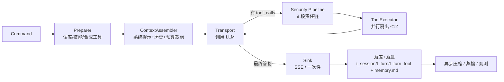

# CClaw 功能与技术特性说明

> 本文依据 `src/` 当前代码整理（2026-11-11）。
> 版本号 / Commit / 构建时间由 `-ldflags` 注入（见 `agentService.initialization.getVersion`）。

---

## 1. 项目定位

**CClaw 是一个面向私有化部署的企业级Agent OS**：以单个可执行文件启动 HTTPS 服务，为每个「租户 / Agent」维护独立的工作区与长期记忆，在受控工具集内驱动大模型完成实际的读写、检索与命令执行任务，并通过 SSE 把执行过程实时推给 Web 前端。

它解决的不是「调一次 LLM API」，而是**让模型在可观测、可止损、可回溯的边界内持续干活**：

- 上下文会无限增长 → 分层压缩 + 长期记忆蒸馏；
- 工具调用会失控 → 循环守卫 + 无进展守卫 + 预算熔断；
- 工具执行有风险 → 权限责任链 + 路径白/黑名单 + OS 级沙箱；
- 长任务会拖垮进程 → 两级并发闸 + 统一 goroutine 托管 + 可中断流式输出。
- 可应用于不良资产投资领域的尽职调查（已经加了相应的SKILL.md）

---

## 2. 组成与分层

### 2.1 代码模块

| 模块                          | 路径               | 职责                                                         | 是否在 `go.work`       |
| ----------------------------- | ------------------ | ------------------------------------------------------------ | ---------------------- |
| `my.favorite/agentService`    | `agentService/`    | 进程入口：配置定位、初始化顺序、信号等待、退出清理、Swagger  | ✅                      |
| `my.favorite/cclawservice`    | `cclawservice/`    | 业务域：Agent 管理、对话编排、工具执行、上下文/记忆、安全、可观测性 | ✅                      |
| `my.favorite/platformutility` | `platformutility/` | 平台底座：Web 框架中间件、配置、数据库、缓存、日志、错误模型、并发治理 | ❌（经 `replace` 依赖） |
| `my.favorite/tui-engine`      | `tui/`             | 独立的终端客户端（Bubble Tea），与服务端解耦                 | ❌（独立构建）          |
| —                             | `cclawchat/`       | 纯静态 Web 前端（无构建步骤）                                | —                      |


---

## 3. 功能清单

### 3.1 账号与鉴权

- 账号表 `t_account` 带租户码（`com_code`），支持按租户隔离 Agent 与工作区。
- 登录采用 **HMAC-SHA256** 挑战应答：口令不落明文，以账号自带的 `login_key` 为密钥计算 `login_pass = HMAC-SHA256(login_key, password)`；返回带有效期与签发时间的 token。
- 会话标识存于前端 `sessionStorage`，登出/刷新丢失后需重新登录。
- 无需 token 的接口通过 `unWantedTokenUrls` 白名单显式声明（默认仅 `/api/login`）。

### 3.2 Agent 管理

四类对象，全部支持列表 / 新增 / 更新 / 删除：

| 对象         | 表                          | 说明                                            |
| ------------ | --------------------------- | ----------------------------------------------- |
| LLM Provider | `t_llm`                     | 模型接入点：baseURL、模型名、密钥、上下文窗口等 |
| Agent        | `t_agent`                   | 人格与工作区配置、默认模型、并发上限、启停状态  |
| Skill        | `t_skill` + `t_agent_skill` | 以 `SKILL.md`（front matter）声明的能力与工具   |
| 路由规则     | `t_agent_route_rule`        | 按条件把请求路由到不同 Agent / 模型             |

- 列表读**启动时加载的内存缓存**，CRUD 后同步更新，避免每请求查库。
- 更新使用**乐观锁**（`d_version`）：并发编辑时后提交者得到 409 冲突，而不是静默覆盖。
- Agent 支持读取/编辑**启动文档**（`/agent/startupFiles`、`/agent/startupFile`）。

### 3.3 对话能力

三种形态，共用同一套编排：

| 接口                       | 形态                       | 特点                                         |
| -------------------------- | -------------------------- | -------------------------------------------- |
| `POST /api/chat`           | 一次性 JSON                | 简单集成；超时由应用层 `chatRunTimeout` 控制 |
| `POST /api/chat/stream`    | SSE（`text/event-stream`） | 逐事件推送（见下表），写完发 `[DONE]` 哨兵   |
| `POST /api/chat/interrupt` | 中断                       | 按 `turnId` 取消在飞轮次                     |

**并发控制分三层**：

1. 全局聊天闸 `maxChatConcurrency`（默认 1000）与流式闸 `maxStreamConcurrency`（默认 800）；
2. 每 Agent 闸 `DefaultAgentConcurrency`（默认 8，可用 `t_agent.max_concurrent` 覆盖），等待超过 30s 返回「Agent 忙」；
3. 单轮工具扇出上限 `maxToolFanout = 12`。

**执行流水线**（`cclawservice/chat/`）：



- `TurnState` 一轮一个实例，生命周期严格等于一次 `execute`，天然免锁。
- 中断/断连时由 ctx 取消传播，工具与 LLM 调用共享同一取消链。

**SSE 事件类型**

| 事件        | 载荷                        | 用途                                |
| ----------- | --------------------------- | ----------------------------------- |
| `message`   | 增量正文 / 字符串 `[DONE]`  | 正文流式输出；`[DONE]` 表示本轮结束 |
| `thinking`  | 思考/准备阶段文案           | 让用户知道「模型在做什么」          |
| `status`    | 阶段状态                    | 准备中、等待模型、生成中            |
| `tool`      | 工具名、参数摘要、进度/结果 | 工具调用可视化（含心跳）            |
| `notice`    | 提示文案                    | 预算裁剪、守卫提示等非错误提醒      |
| `interrupt` | 中断原因                    | 用户中断或客户端断开                |
| `error`     | 业务码 + 用户文案           | 终止性错误                          |

写事件是**串行**的（`emit` 持锁），且每次写完 `Flush`；一旦发现 `ctx.Err() != nil` 或写失败，立即标记 `dead` 并主动取消上游，避免「写不出去还在空转」。

### 3.4 提示词与 Agent 工作区

工作区位于 `<exeDir>/cclaw/<ownerCode>/<agentDir>/`，由 7 个 Markdown 文件组成，按固定顺序注入：

| 文件           | 作用                       | 必需性     |
| -------------- | -------------------------- | ---------- |
| `AGENTS.md`    | 运行规则                   | 必需       |
| `SOUL.md`      | 人格 / 语气 / 边界         | 可选       |
| `TOOLS.md`     | 工具使用指引               | 可选       |
| `IDENTITY.md`  | 名称 / 形象 / emoji        | 可选       |
| `USER.md`      | 用户画像与偏好             | 可选       |
| `BOOTSTRAP.md` | 首次运行引导（仅新工作区） | 可选       |
| `MEMORY.md`    | 跨会话长期记忆             | 存在才注入 |

**关键设计**：`MEMORY.md` 被拆成「静态区 + 动态区」，静态内容前置以最大化命中 LLM 的 prompt cache；当前时间、记忆自动区、摘要、SOP 全部后置到动态区，避免每秒变化的内容击穿缓存。

### 3.5 工具系统

- **内置系统工具 6 个**：`read`、`write`、`edit`、`glob`、`grep`、`bash`。
- **技能脚本工具**：`SKILL.md` 的 front matter 声明，运行时派生为 LLM 侧 tool schema 与脚本绝对路径；读盘与 YAML 解析统一走 `LoadSkills`（按文件指纹缓存）。
- **执行模型**：一轮内多个 `tool_calls` 并行扇出（受 `maxToolFanout` 与全局名额双重约束），结果按原下标回填，保证顺序与模型请求一致。
- **两阶段台账**：`ToolLedger.Start`（发起即登记）→ `Finish`（回填结果摘要）。用户中断时后续代码可能不执行，因此登记必须早于任何可能失败的动作。
- **心跳**：长时间运行的工具定期上报进度，前端可见「正在做什么」，避免长任务表现得像卡死。

### 3.6 上下文与记忆

记忆分三层，写入与读回严格对应：

| 层       | 载体                                                         | 写入者          | 读回者                                                 |
| -------- | ------------------------------------------------------------ | --------------- | ------------------------------------------------------ |
| 会话记录 | `t_session` / `t_turn` / `t_turn_tool` + `memory_<sessionId><时间>.md` | `MemoryService` | `GetSessions` / `GetSessionTurns` / `ContextAssembler` |
| 会话压缩 | 历史文件内的 `summary` 记录                                  | `Compressor`    | `ContextAssembler`（折叠 `covers` 区间）               |
| 长期记忆 | Agent 工作区 `MEMORY.md`                                     | `Distiller`     | 提示词装配                                             |

- **压缩（compact）**：把一段旧记录浓缩为一条摘要记录，使历史体积有界且不丢早期信息。**异步执行、不阻塞回复、幂等、按会话串行**（专用锁键），失败只记日志——记忆是增强能力，不能成为聊天链路的故障点。
- **蒸馏（distill）**：只沉淀「跨会话仍有效」的单位/Agent 级事实（项目结构、口径、约定、决策）。作用域是 `(租户, Agent)`，会被注入每次请求，因此提示词中硬性禁止写入个人隐私（个人画像归 `USER.md`）。
- **读回映射**：`user` → `role=user`；`tool` → 折叠进同轮 assistant 的工具结果块；`assistant` → `role=assistant`（被中断的回复加 `InterruptedReplyNotice` 前缀，避免模型把残缺正文当成完整发言）；`summary` → 折叠进 system 的历史摘要段。
- **预算裁剪**：`TokenBudgeter` 对 system / 历史 / 工具清单 / 本轮输入分别做预算，超限按「保前丢后」策略截断，并在 prompt 中显式标注「清单以本清单为准」。

### 3.7 安全与沙箱

**请求层**

- HTTPS（证书 + CA 目录可配，支持 `ssl=false` 仅内网调试）。
- 地址/URL 黑白名单、CORS 白名单、请求体上限 2MB。
- **防重放**：`NONCE` + `TIMESTAMP`（与服务器双向时间差 ≤ 5 分钟）+ 请求体签名（`signKey`）。Nonce 用 Redis `SET NX EX` 原子「检查并写入」，一次往返消除竞态；Redis 异常时 fail-open。

**工具层（9 段责任链，顺序敏感）**

```
ValidateInput → PreToolUseHook → DenyRule(硬拒绝) → AskRule(强制确认)
→ ToolSelfCheck → SafetyGuardrail(抗绕过) → PermissionMode
→ AllowRule(自动放行/只读) → InteractiveConfirm(链尾)
```

- `toolRule` 段可整体开关（`policyEnabled`）、单独开关 `functionCalling` / `allowShell` / `sandboxEnabled` / `sandboxNetwork`。
- 路径策略：`readRoots` / `writeRoots` 白名单；`denyRoots` 黑名单默认覆盖 `~/.ssh`、`~/.aws`、`~/.gnupg`、`~/.kube`、`.env`、`*.pem`、`*.key`、`/etc/shadow` 等。
- **OS 级沙箱**：抽象为 `Sandbox` 后端，当前实现为 macOS `sandbox-exec`（Seatbelt）；不可用时明确报错而不是静默降级。

**链路层（防失控）**

| 守卫            | 检测目标                                                     |
| --------------- | ------------------------------------------------------------ |
| `LoopGuard`     | 总调用次数、连续失败次数、同一工具连打、完全相同的调用、A/B/A/B 二元交替 |
| `ProgressGuard` | 「每一步都不同但结果零新信息」的盲区：最近 W 次成功调用的结果签名（已归一化时间戳/UUID/长数字）连续 K 次重复 |
| `ChatToolGuard` | 命中提示后模型仍不收敛 → 终止本轮，避免空转到 `AgentToolLoopMax` |
| `TokenBudgeter` | 预算熔断，防止上下文/输出超限                                |

三者共享同一取向：**宁可漏判，不可误杀合法长任务**；阈值保守、窗口有界、只对「成功且足够长」的结果做判定。

### 3.8 可观测性

- **Observer 体系**（`harness/observatory`）：token 用量、阶段耗时（timing）、技能命中（skill）。
- **并发统计**：`Inflight / MaxInflight / Started / Completed / Failed / Panicked / Rejected`，支持全局与按任务名（`ByTask`）两种视角。
- **慢任务告警**：单任务超过 `SlowThreshold`（默认 60s）打 WARN，并记录 `TotalMs / SlowestMs / SlowestTaskId`。
- **关停统计**：退出时打印 `inflight=before->after maxInflight=… global started=… completed=… failed=… panicked=… rejected=…`，可直接判断「是否有任务被丢」。

### 3.9 会话历史

- 写入：一轮结束写 `t_turn`（问题/回复在历史文件中的索引），工具逐条写 `t_turn_tool`（顺序号 + 返回值摘要），内容按真实发生顺序追加到 `memory_*.md`。
- 读取：`POST /api/GetSessions`（按用户、时间倒序）与 `POST /api/GetSessionTurns`（某会话最近 N 轮），前端已接入（`SESSIONS_PATH` / `SESSION_TURNS_PATH`）。
- 并发：会话内 `seq` 与文件 `index` 都是「读最大值 + 1」，统一由 `GetSessionLocks()` 按 `sessionId` 加锁，避免并发写坏序号。
- 开关：`[chat] sessionRecord`，关闭后为纯旁路，不影响主流程。

### 3.10 Web 前端

- 纯静态 ES Module，**无构建步骤**：`index.html → main.js → modules/*`。
- 页面以 Shadow DOM 组件挂载（`login` / `home` / `chat`），样式与脚本隔离。
- 流式渲染走 SSE；历史会话列表与轮次由后端接口提供，本地 `localStorage` 作为缓存。
- 静态服务器带 `Cache-Control: no-store`，并对 `main.js → stream.js → api.js` 三级依赖做版本号失效，规避浏览器模块缓存。

---

## 4. 技术特点

### 4.1 统一错误模型（`platformutility/apperr`）

- `Kind` 承载「业务码 + HTTP 状态 + 用户文案 + 是否提醒 + 是否可重试 + 是否静默」，注册期检测「重名 / 重码」并直接 panic，把契约问题挡在启动期。
- `Error` 支持详情、cause 链、`Unwrap / Is`，因此 `errors.Is(err, SomeKind)` 与 `apperr.Of(err)` 同时可用。
- 业务码按域分段（用户/登录 3xxx、Agent 4xxx、聊天 46xx 等），绝对码值由 `exception` 包的契约测试锁定，防止前端按 code 分支时被无意改号。
- `Notify` 语义区分「必须显式提醒用户」与「可降级为通用提示」，避免 SSE 已经输出一半时把原因吞掉。

### 4.2 统一并发治理（`platformutility/concurrency`）

全仓**唯一**创建 goroutine 的入口（业务代码禁止裸 `go`）：

```go
m := concurrency.GetTaskManager()
m.Go(ctx, spec)      // 即发即弃
m.TryGo(ctx, spec)   // 拿不到名额立即返回
s := m.NewScope("req-1", 4); s.Go(ctx, spec); s.Wait(ctx)
m.Daemon(spec)       // 进程级常驻
```

- **两级名额**：全局 `MaxInflight`（默认 1024）+ 每个 scope 的限额，避免单个请求把进程打满。
- **统一记账**：唯一出口 `onFinished` 负责 inflight、耗时、失败/完成、慢任务告警，避免多处重复计数。
- **panic 隔离**：`RecoverPanic`（默认）把 panic 转成 error 并计数；`CrashPanic` 才交给进程兜底。
- **可诊断的超时**：`DrainTimeoutError` 给出超时时间、scope 名与仍在运行的任务快照（名称/scope/真实耗时）。
- **终态操作受控**：`Drain / CancelScope / CancelDaemon / Close` 只能出现在进程退出路径（见 4.4）；测试通过 `NewTaskManager` + `SwapTaskManager` 使用**独立实例**，不改动也不复位全局单例。

### 4.3 优雅停机（`ServiceMain.Destroy`）

严格按「先停接入 → 再排空 → 后释放下游 → 最后关日志」执行：

1. `baseRouter.Shutdown()`：停止接受新连接，SSE 长连接超时可接受（WARN 而非 ERROR）；
2. `TaskManager.Close(nil)`：`CancelScope` → `CancelDaemon` → `Drain`，超时由 `TaskConfig.DrainTimeout`（默认 10s）兜底；
3. 传输池 / Agent 并发闸 / 工具仓库；
4. 各类 Repo 与文档缓存；
5. 数据库；
6. Redis（含健康检查协程收尾）；
7. 配置；
8. `logging.CloseLogger()`：**最后**关闭，保证前面所有阶段还能打日志。

> 注意：启动失败路径调用 `os.Exit(1)`，Go 会跳过 `defer`，因此 `Destroy` 不会执行。这是有意的——此时进程即将消失，无需排空。

### 4.4 配置系统（`platformutility/config`）

同一套 `ConfigurationHelper` 抽象支持 ini / json / yaml / properties 四种格式，并带缓存 TTL 与热加载能力。服务端主配置为 ini，分 8 段：

| 段           | 作用                                                         |
| ------------ | ------------------------------------------------------------ |
| `[server]`   | 端口、SSL、证书、超时、全局聊天/流式闸、Swagger              |
| `[socket]`   | 历史遗留：仅 `platformutility/heaven`（当前不可达）读取，本版本未启用 |
| `[logging]`  | 日志目录                                                     |
| `[security]` | 黑白名单、免 token URL、签名密钥、CORS                       |
| `[database]` | 关系库类型/连接池/重试/缓存 TTL                              |
| `[memoryDb]` | Redis 连接池、超时、健康检查间隔                             |
| `[toolRule]` | 工具策略总开关、沙箱、路径白/黑名单                          |
| `[chat]`     | 会话记录开关                                                 |

关键取舍：`[server] writeTimeout=0` 显式关闭 HTTP 写超时，让 SSE 与长任务的上限由**应用层** `chatRunTimeout` 决定，而不是被传输层静默掐断。

### 4.5 数据访问

- GORM v1.31，同一接口支持 **SQLite**（默认 `dbType=3`，单机/内网）与 **PostgreSQL**（多实例）。
- 连接池参数、重试（指数退避 + 抖动）、`reloadCacheTTL` 全部可配。
- 多实例共享同一连接池：`GetCommonDatabase` 多次调用不会新建 pool。
- 表结构见 `data/ddl_sqlite3.sql`，共 9 张业务表：`t_llm`、`t_agent`、`t_skill`、`t_agent_skill`、`t_agent_route_rule`、`t_session`、`t_turn`、`t_turn_tool`、`t_tool`。账号表 `t_account` 存在于运行库但不在该 DDL 内（由既有数据导入，带租户码与 `login_key`）。

### 4.6 安全设计取向

| 取舍                              | 理由                                        |
| --------------------------------- | ------------------------------------------- |
| Nonce 用 Redis `SET NX EX`        | 一次往返完成「检查 + 写入」，无 TOCTOU 竞态 |
| Redis 异常时 nonce 校验 fail-open | 可用性优先；时间窗 + 签名仍在生效           |
| 沙箱不可用时明确报错              | 避免「以为隔离了」的静默降级                |
| 责任链顺序硬编码且不可覆盖        | Deny 必须在 Ask/Allow 之前，顺序即安全      |
| 守卫宁可漏判                      | 误杀合法长任务比漏判一次可疑循环代价更高    |

## 5. API 一览

| 方法 | 路径                                           | 鉴权 | 说明                             |
| ---- | ---------------------------------------------- | ---- | -------------------------------- |
| GET  | `/heartbeat`                                   | 否   | 健康检查                         |
| POST | `/api/login`                                   | 否   | 登录，返回 token                 |
| POST | `/api/logout`                                  | 是   | 登出                             |
| POST | `/api/llmProviders`                            | 是   | 模型接入点列表                   |
| POST | `/api/llmProvider/add` · `/update` · `/remove` | 是   | 模型接入点 CRUD                  |
| POST | `/api/agents`                                  | 是   | Agent 列表                       |
| POST | `/api/agent/add` · `/update` · `/remove`       | 是   | Agent CRUD                       |
| POST | `/api/agent/startupFiles`                      | 是   | 启动文档清单                     |
| POST | `/api/agent/startupFile`                       | 是   | 读/写单个启动文档                |
| POST | `/api/skills`                                  | 是   | 技能列表                         |
| POST | `/api/skill/add` · `/update` · `/remove`       | 是   | 技能 CRUD                        |
| POST | `/api/chat`                                    | 是   | 一次性对话                       |
| POST | `/api/chat/stream`                             | 是   | SSE 流式对话                     |
| POST | `/api/chat/interrupt`                          | 是   | 中断指定轮次                     |
| POST | `/api/GetSessions`                             | 是   | 会话列表（倒序，默认最近 15 条） |
| POST | `/api/GetSessionTurns`                         | 是   | 某会话历史轮次（默认最近 15 轮） |

> 实现上除 `/heartbeat`（GET）外，全部业务路由统一注册为 **POST**（`base_router_server.go` 内 `GinEngine.POST`），参数一律走请求体。

所有受保护接口都需要 `NONCE` + `TIMESTAMP` 查询参数与 `AUTHORIZATION` 头。

---

## 6. 构建、运行与测试

```bash
# 构建（产物在 bin/，配置同时拷贝到 bin/config）
./build_agentService.sh

# 运行
bin/agentService

# 前端（静态服务器，root 为 src/）
sh .vscode/scripts/serve.sh 5500
# → http://localhost:5500/cclawchat/index.html

# 测试
cd cclawservice && go test ./... -race                       # 业务模块
cd cclawservice && go test ./archtest/ -v                     # 架构守卫
cd cclawservice && go test my.favorite/platformutility/concurrency/ -race
cd platformutility && go test ./... -race                    # 平台底座（不在 go.work）
```

> `platformutility` 不在 `go.work` 内，`cclawservice` 通过 `replace` 引用它，因此 `go test ./...` **不会**自动覆盖该模块，CI 需显式追加一条。

---

## 8. 已知边界与演进方向

| 项                       | 现状                                | 影响                                                         |
| ------------------------ | ----------------------------------- | ------------------------------------------------------------ |
| 沙箱后端                 | 仅 macOS `sandbox-exec`（Seatbelt） | Linux/Windows 上 `sandboxEnabled=true` 会明确报不可用        |
| 平台缓存                 | Agent/LLM/Skill 列表为进程内缓存    | 多实例部署时需依赖 DB 变更 + `reloadCacheTTL` 刷新，非强一致 |
| `platformutility/heaven` | 历史遗留、当前不可达                | 架构守卫白名单中已标注「待删除」                             |
| `tui` 模块               | 独立 module，未纳入 `go.work`       | 需单独构建/测试                                              |
| 压缩与蒸馏               | 异步、失败只记日志                  | 极端情况下记忆可能滞后，但不影响回复                         |
| 会话记录的压缩质量       | 依赖 LLM 摘要                       | 长会话的早期细节会退化，重要事实应写入 `MEMORY.md`           |
