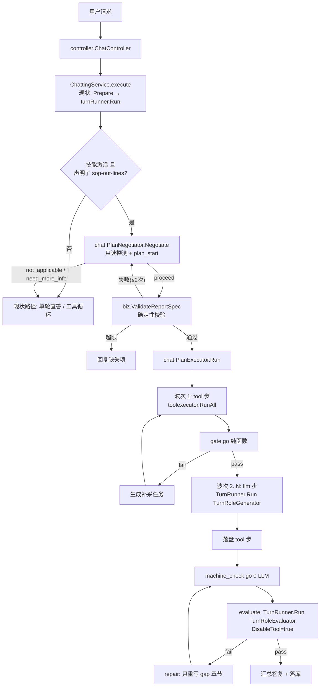
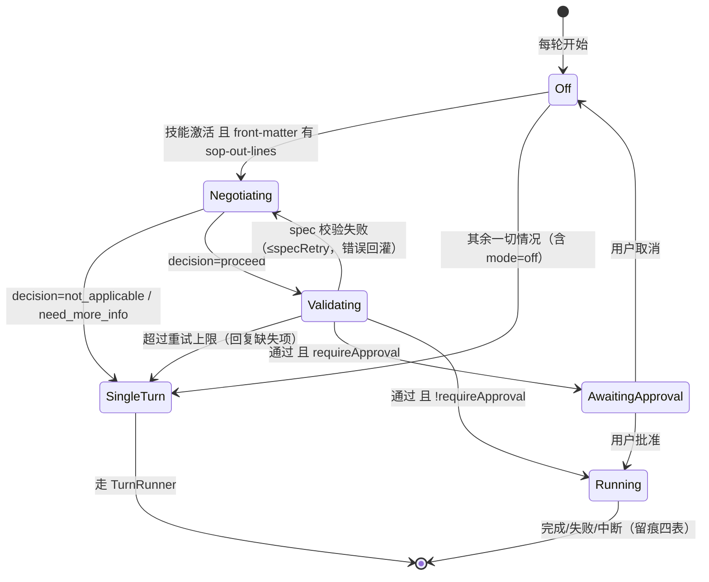

# 多 Agent 协作实现方案（基于现有代码结构 · SOP 驱动）

- 版本：v3.0.0
- 日期：2026-11-13
- 状态：待评审
- **取代关系**：本文件取代《多 Agent 协作实现方案》（`多Agent协作实现方案.md`）§4「阶段一：分诊」与 §13.3/§13.4 的 **M2（复杂度纯函数）**。
  其余（§6 DAG/监控、§7 评估、§9 数据模型、§10 事件）继续有效，但**文件路径与接口以本文件为准**（按仓库实际代码重写）。
- **不变**：M0（决策 + 基线）与 M1（单轮执行单元）已完成，本方案在其之上继续。

---

## 0. 一句话

取消"用正则判断复杂/简单再决定要不要协作"，改为：

> **命中技能 SOP（SKILL.md 声明）→ 0 LLM 展开计划 → 按波次执行 → 每步过门禁 → 机检 + 评审 + 修复**

复杂度不再是**判定**，而是**计划规模的副产物**（任务数 / 波次 / 预算）。

对客效果：一类需求（如"写某资产包的个贷不良尽调报告"）从"一个 Agent 一口气做完、好坏看运气"，变成"声明式 4 步状态机 + 逐章节撰写 + 机检 + 独立评审 + 定点修复"。

---

## 1. 现状代码结构盘点（本方案的地基）

### 1.1 包职责

| 包 | 现有职责 | 本方案新增 |
|---|---|---|
| `chat/` | 领域编排：`Preparer`（路由→provider→技能→prompt→工具→预算）、`TurnRunner`（并发闸→中断登记→超时→建档→装配→生成→记账）、`ToolLoop`（多轮工具）、`ISink`、`MemoryJournal`、`ToolsBundle` | `plan_model.go`、`plan_from_outline.go`、`plan_executor.go`、`gate.go`、`machine_check.go`、`artifact_registry.go`、`evaluator_assign.go`、`compose_prompt.go`、`evaluate_prompt.go` |
| `harness/ctxmgr` | `AgentRouter.Resolve`、`AgentDocumentCache.LoadSkills`（**SKILL.md 唯一读盘入口**）、`BuildSystemPromptWithSkills`、`GetContextPolicy`、`MemoryService`/`TurnRecorder`、`KeyTokenPattern` | `skill_outline.go`（`SkillStep` 定义 + linter） |
| `harness/common` | `SkillFrontMatter`（`harness_common.go:357`）、`BasicTool`、`SkillDocument`、`ContextPolicy`、各类常量 | `SkillFrontMatter.Outline []SkillStep` |
| `harness/toolexecutor` | `ToolEnv`/`ToolSpec`/`ToolInvocation`/`ToolOutcome`/`ToolConfigRules`、`IToolRoundExecutor`（串行/并行）、`GetScriptsResolver`、`GetSimpleScriptExecutor`、`ToolEvent(Sink)`、120s 脚本超时 + 120s 工具轮收敛 | 无（直接复用） |
| `service` | `ChattingService`（`preparer`/`turnRunner`/`transport`/`syncLooper`/`asyncLooper`/`journal`/`memoryMaintainer`/`agentConcurrent`/`turnRegistrator`/`turnReporter`/`toolConfiguredRules`）；`execute` = `Prepare` + `turnRunner.Run` | 注入 `planExecutor`；`execute` 增加"命中 outline → 走计划"的分支 |
| `controller` | `SSEPresenter` 实现 `chat.ISink`（`OnDelta/OnReasoning/OnTool/OnStatus/OnNotice/OnJournal/OnFinishReason`），私有 `emit(name,payload)` | 新增 `OnPlan/OnTask/OnGate/OnEvaluate` 四个公开方法 |
| `model/repo` | `AgentRepository`：`GetAgents(comCode)`、`GetAgent(ownerId,agentId)`、`GetSkillsByAgent(agent)`、`GetSystemTools()` | 无 |
| `model/dataobject` | `TAgent`（`SkillIds`/`MaxConcurrents`/`PrimaryModel`/`Fallbacks`）、`TSkill`（`SkillDir`，`t_agent.go:231`）、`TTool` | `TPlan`/`TTask`/`TGap`/`TRunArtifact` |
| `model/dataaccessor` | `ISessionAccessor`（`t_session`/`t_turn`/`t_turn_tool` 读写与落库） | `IPlanAccessor`（四表增量写 + 查询） |

### 1.2 已经可用、不要重造的能力

| 能力 | 现有入口 | 本方案怎么用 |
|---|---|---|
| 技能意图门 + 工具可见性 | `chat.ToolsBundle.Activate(question)` → `VisibleTools(gate)` / `PromptItems()` / `Specs` | 判断"该不该走 SOP"，并把工具集折算成执行器可用集合 |
| SKILL.md 读盘与缓存 | `AgentDocumentCache.LoadSkills(skillFiles) ([]hCommon.SkillDocument, observatory.SkillLoadReport)` | 读取新增的 `FrontMatter.Outline` |
| 工具名 → 脚本路径 | `toolexecutor.GetScriptsResolver(bundle.Specs)` → `TurnState.Scripts` | 计划里的 `tool: npa_ingest` 由此解析，**计划里不写路径** |
| 单次工具执行 | `toolexecutor.NewRoundExecutorSerial(GetSimpleScriptExecutor()).RunAll(ctx, env, invocations, sink, ledger)` | `kind=tool` 的步骤（1 次调用即可） |
| 单轮 LLM 执行 | `chat.TurnRunner.Run(ctx, TurnRequest{...})`（M1） | `kind=llm` 的撰写/评估步骤 |
| 上下文隔离 | `Preparer.PrepareFor(ctx, cmd, agent, TurnRole)` + `AllowRecord:false` | 子任务不读父历史、不写父历史 |
| 工具安全策略 | `toolexecutor.ToolConfigRules`（`AdmitRule`）+ `TurnState.NewToolEnv(rules)` | 每步不同策略（撰写只读 / 评估无工具） |
| 观测 | `observatory`（turn/llm/tool timing）、`hCommon.ChatRunTimeout` 等 | 波次耗时、预算与 p95 估算 |
| goroutine 治理 | `archtest` 禁止裸 `go`；统一走 `concurrency.GetTaskManager()` | 波次并行**必须**用 `NewScope(...).Go(...)` |

### 1.3 现有 M1 契约（本方案直接依赖，不改）

```go
// chat/turn_common.go（现状）
type TurnRole int
const (
    TurnRoleRoot      TurnRole = iota + 1 // 入口轮
    TurnRoleGenerator                     // 子任务：目标 Agent 由计划给定
    TurnRoleEvaluator                     // 统一评估
)

type TurnRequest struct {
    Cmd          Command
    Turn         *TurnState // 必须由 PrepareFor 构造完成
    Role         TurnRole
    Sink         ISink
    AllowRecord  bool   // 写历史
    DisableTool  bool   // 本轮禁用工具
    ParentTurnID string // 父轮 turnID（当前未被使用，本方案启用）
    StartAt      time.Time
}

type TurnOutcome struct {
    TurnReply      Reply
    Llm            llmproto.LlmReply
    Rounds         int
    ToolCalls      int
    ElapseMs       int64
    FirstVisibleMs int64
}

type ITurnRunner interface {
    Run(ctx context.Context, req TurnRequest) (TurnOutcome, error)
}
```

> 现状**没有** `TurnKind`/`TurnRequest.Agent`/`UserMsg`。本方案按现状落地：
> 子任务的"用户消息"通过**构造一个专用 `Command`**（`Message` = 章节任务书）实现；
> `TurnRoleGenerator` + `AllowRecord:false` 已达上下文隔离；`DisableTool` 给评估轮。

---

## 2. 为什么放弃"复杂度分类"

| 错位 | 说明 | 反例 |
|---|---|---|
| 知识位置错 | 流程本来写在 `bin/cclaw/skills/npa-report/SKILL.md`（4 步状态机 + 7 章节 + 运行契约 + 材料对账硬要求）。Go 再写一份必然漂移 | SOP 改了步骤顺序，代码判据不知道 |
| 判据错 | 中文措辞无穷；"复杂"其实是"要几步、步间有什么依赖"的**结果** | "写 10罗勇兴 的尽调报告"9 个字，实际是 4 步工具 + 2 次 LLM |
| 时机错 | 参考 Claude Code：**先做，边做边扩计划** | "要 OCR"是第 1 步跑完才知道的，事前无法判定 |

代价对比：SOP 展开是 **0 次 LLM、确定性、可单测**；分类器"省一次 LLM"却可能把需要 4 步的活判成 simple 让单 Agent 硬扛。

### 2.1 同样不该用正则猜参数：Plan Mode 的四道闸门

放弃复杂度分类之后，第一版实现把"要不要做计划"又交给了 `ResolveNPAReportSpec`（正则扫绝对路径 + 正则抓档案号 + 捞不到就静默退回单轮）。这是同一个错误的另一种形状：**用 Go 代码猜意图**。三个具体缺陷：

| 缺陷 | 表现 | 后果 |
|---|---|---|
| 猜参数 | 用户说"桌面那个案子" → 猜不到，静默退到 `WorkRoot` | 对着错误目录跑 500 个 PDF |
| 猜后无校验 | 正则从"档案号是 2024 年的"里抓出 `2024` | 假档案号写进报告抬头 |
| 决策不可审计 | `ok=false` 直接 return，什么都不留 | 用户与开发都不知道这轮为什么没走流程 |

参考 Claude Code 的 plan mode，把三件事拆开，各归其位：

| 概念 | 谁负责 | 可否被覆盖 |
|---|---|---|
| 要不要做（`decision`） | **LLM** 在协商轮显式表态 | 只能被"否决为不做"，不能被强制为做 |
| 参数（`ReportSpec`） | **LLM** 按 schema 填写 | 被确定性校验器否决后回灌重试 |
| 怎么做（`Plan`） | **Go** 从 `SKILL.md` 确定性展开（0 LLM） | 不受模型影响 |

**总约定：Go 里的启发式只允许作为提示（prompt hint），永不允许参与决策。** 详见 §8.1。

---

## 3. 设计原则（Claude Code 可迁移机制 → 现有代码落点）

| 机制 | 本质 | 落点 |
|---|---|---|
| 计划是**可增删改的运行时状态** | 计划不是一次性产出 | `Plan` + `RunState`；门禁失败插入补采任务 |
| 能力来自**已注册工具** | "能不能做"由工具表决定 | `SKILL.md tools[]` → `ToolsBundle.Specs` → `ScriptsResolver` |
| **观察驱动** | 复杂度是"发现"的 | 门禁纯函数 → `Gap` → 新任务 |
| **验证闭环** | 完成与否由检查器决定，不由模型自称 | `gate.go` + `machine_check.go` + `rubric` |
| **子代理隔离** | 拆到独立上下文，只回传结论 | `TurnRunner` + `TurnRoleGenerator` + `AllowRecord:false` |
| **Plan Mode 是显式状态** | 模式不是一个布尔推断，而是可观测的状态机 | `planMode` 四态（§8.1.2）；协商轮只挂只读工具 |
| **终止工具表达"开始执行"** | 用一次显式工具调用代替"从回答里猜" | 协商轮强制调用 `plan_start` |
| **只读阶段与写入阶段分离** | 计划阶段不得有副作用 | 协商轮不给 `npa_ingest`，只给 `fs_list`/`fs_stat` |

---

## 4. 目标架构与现有代码的接缝



**唯一的入口改动**（`service/chatting_service.go`）：

```go
// execute 现状：Prepare → turnRunner.Run
// 改为：
turn, err := s.preparer.Prepare(tmpCtx, cmd)              // 不变
if plan, spec, ok := s.resolvePlan(tmpCtx, turn, sink); ok {   // ③协商 → ④校验 → 展开
    return s.executePlan(tmpCtx, turn.Cmd, turn, plan, spec, sink, start, &firstVisibleMs)
}
// 否则保持现状（协商失败一律走这里，等价今天的正确基线）
res, err := s.turnRunner.Run(tmpCtx, chat.TurnRequest{...})
```

`resolvePlan` 不再做任何猜测，只做三件事：取激活技能的 `sop-out-lines` → 调协商轮 → 调校验器。依赖都是现成对象：`turn.SkillDocs`/`turn.ActiveSkills`（`Preparer` 已填充）、`turn.ScriptRules`、`turn.WorkRoot`。

---

## 5. 声明式 SOP（`SKILL.md` front-matter）

### 5.1 为什么放 `SKILL.md`

- 业务流程唯一真相源；改流程不改 Go；
- 新增一类报告 = 新增一个技能目录，代码零改动；
- 与现有链路天然对齐：`LoadSkills` 已解析 front-matter（`hCommon.SkillFrontMatter`），只需加一个字段。

### 5.2 字段定义（`harness/common/harness_common.go`）

```go
// SkillStep SKILL.md 的声明式流程步骤（本方案新增）
type SkillStep struct {
    ID       string            `json:"id" yaml:"id"`
    Kind     string            `json:"kind" yaml:"kind"` // tool | llm | check
    Tool     string            `json:"tool,omitempty" yaml:"tool,omitempty"`
    Role     string            `json:"role,omitempty" yaml:"role,omitempty"` // kind=llm
    Needs    []string          `json:"needs,omitempty" yaml:"needs,omitempty"`
    Produces string            `json:"produces,omitempty" yaml:"produces,omitempty"`
    When     string            `json:"when,omitempty" yaml:"when,omitempty"`
    Args     map[string]string `json:"args,omitempty" yaml:"args,omitempty"`
    Sections []string          `json:"sections,omitempty" yaml:"sections,omitempty"`
    Contract *StepContract     `json:"contract,omitempty" yaml:"contract,omitempty"`
    Checks   []string          `json:"checks,omitempty" yaml:"checks,omitempty"`
    Gate     string            `json:"gate,omitempty" yaml:"gate,omitempty"`
    Policy   string            `json:"policy,omitempty" yaml:"policy,omitempty"`
    MaxTries int               `json:"maxTries,omitempty" yaml:"max-tries,omitempty"`
    OnFail   string            `json:"onFail,omitempty" yaml:"on-fail,omitempty"`
    MaxRounds int              `json:"maxRounds,omitempty" yaml:"max-rounds,omitempty"`
}

type StepContract struct {
    Cite         string `json:"cite,omitempty" yaml:"cite,omitempty"`                   // required
    ForbidInvent bool   `json:"forbidInvent,omitempty" yaml:"forbid-invent,omitempty"`   // 缺字段写"未见/待补充"
    MaxChars     int    `json:"maxChars,omitempty" yaml:"max-chars,omitempty"`
}

// SkillFrontMatter 增加：
//   Outline []SkillStep `json:"outline,omitempty" yaml:"outline,omitempty"`
```

### 5.3 `npa-report` 的完整声明（可直接合并进现有 front-matter）

```yaml
outline:
  - id: ingest
    kind: tool
    tool: npa_ingest                    # 必须是本技能 tools[] 里已注册的名字
    produces: parsed_context
    gate: materials_manifest
    args: { recursive: "true", emit_stdout: "false" }
    max-tries: 2

  - id: ingest_ocr
    kind: tool
    tool: npa_ingest
    when: gate_failed(materials_manifest)
    needs: [parsed_context]
    produces: parsed_context
    args: { ocr: "true", path: "${parsed_context.ocr_dirs}" }
    gate: materials_manifest
    max-tries: 2

  - id: extract
    kind: tool
    tool: npa_extract_metrics
    needs: [parsed_context]
    produces: extracted_metrics
    gate: metrics_reconciled
    args: { input: "${parsed_context.path}" }
    max-tries: 2

  - id: compose
    kind: llm
    role: analyst
    needs: [parsed_context, extracted_metrics]
    produces: draft
    sections: [basic_info, contracts, collateral, litigation, valuation, risk, conclusion]
    contract: { cite: required, forbid-invent: true }
    policy: read_only

  - id: save
    kind: tool
    tool: npa_save_report
    needs: [draft]
    produces: report_path
    args:
      filename: "${spec.archive_no}_个贷不良资产分析报告_${spec.today}.md"
      dir: "${spec.archive_no}/reports"
      content: "${draft.text}"
    max-tries: 2

  - id: verify
    kind: check
    needs: [draft, extracted_metrics, parsed_context]
    checks: [no_invention, numbers_traceable, derived_recompute, section_complete, citations_exist, materials_consistent]

  - id: evaluate
    kind: llm
    role: evaluator
    needs: [draft, verify]
    contract: { cite: required }
    policy: no_tools
    on-fail: repair
    max-rounds: 2
```

### 5.4 linter（确定性，任何工具调用之前执行）

| # | 规则 | 失败 |
|---|---|---|
| L1 | `id` 唯一非空；`kind ∈ {tool,llm,check}` | `plan_invalid` |
| L2 | `needs` 必须指向前序 `produces`；无环、无悬空 | `plan_invalid` |
| L3 | `kind=tool` 的 `tool` 必须在该技能 `tools[]` 中 | `plan_invalid` |
| L4 | `kind=tool` 必须有 `produces`；`kind=check` 必须有 `checks` | `plan_invalid` |
| L5 | 至少 1 个 `kind=llm` | `plan_invalid` |
| L6 | **最末可达步骤必须产出交付物**（本案例 `report_path`） | `plan_invalid` |
| L7 | `sections` 非空 ⇒ `contract.forbid-invent=true` | `plan_invalid` |
| L8 | 不允许出现指定评审者的字段（`verify-agent`/`reviewer` 等，V3） | `plan_invalid` |

L6 把 SOP 的「没调 `npa_save_report` 就不算完成」变成**结构保证**：不可能"只写不落盘"。

---

## 6. 计划模型与展开（0 LLM）

### 6.1 文件：`chat/plan_model.go`（新增）

```go
package chat

type StepKind int

const (
    StepKindTool  StepKind = iota + 1 // 调一个已注册工具
    StepKindLLM                       // 起一轮 TurnRunner
    StepKindCheck                     // 跑机检
)

// PlanTask 一个可执行任务（章节展开后一节一个）
type PlanTask struct {
    ID       string            // compose#basic_info
    Kind     StepKind
    Action   string            // tool 名 / role / check 集合名
    Needs    []string          // 依赖的**产物名**
    Produces string
    Args     map[string]string // 模板,运行时按产物渲染
    Section  string            // kind=llm 且按章节展开时非空
    Gate     string
    Policy   string
    Contract hCommon.StepContract
    ParentID string // 展开来源步骤 id（compose）
    Tries    int
    MaxTries int
    Depth    int
}

type Plan struct {
    SkillID string
    Tasks   []PlanTask
    Waves   int
    Workload Workload // 替代原 M2 的"复杂度"
}

type Workload struct {
    Tasks      int
    Waves      int
    EstTokens  int
    EstLatency int64 // ms
}
```

### 6.2 文件：`chat/plan_from_outline.go`（新增，纯函数）

```go
// BuildPlanFromOutline 把 SKILL.md 的 outline 展开成可执行计划。
// 纯函数：不读盘、不调模型；同输入同输出（供 M3′ 单测与 linter 断言）。
func BuildPlanFromOutline(skillID string, steps []hCommon.SkillStep, spec ReportSpec,
    knownTools map[string]struct{}) (Plan, error)

// 流程：
//  1. L1–L8 lint（失败返回 plan_invalid，附规则号与步骤 id）
//  2. sections 展开：kind=llm && len(sections)>0 -> N 个 PlanTask(ID=compose#<section>, ParentID=compose)
//  3. 计算 Depth = 1 + max(Depth(needs 的产出者))；同层保持声明顺序
//  4. Workload{ Tasks, Waves=maxDepth+1, EstTokens, EstLatency }
//  5. 校验 `when` 只引用已知 gate；`args` 模板只引用已知产物字段
```

**预算估算（替代原 M2）**：

```
EstTokens  = Σ(llm 任务: 章节预算 1.5K~4K) + Σ(tool 任务: 回执上限 8K)
EstLatency = Waves × p95(单轮)   // p95 取 observatory,缺失用 8s
```

`canDelegate(plan)` 用 `Workload` 判预算/时间（评审者存在性另判），不满足则整单回落单 Agent 直答——**不降级成残缺协作**。

### 6.3 产物引用：`chat/artifact_registry.go`（新增）

```go
type Artifact struct {
    Name   string
    Kind   string            // file | dir | json | text
    Ref    string            // 绝对路径 / 文本
    Digest string            // 内容指纹（幂等 + 断点续跑）
    Fields map[string]string // path / files / pages / files_need_ocr / ocr_dirs …
}

type ArtifactRegistry interface {
    Put(a Artifact)
    Get(name string) (Artifact, bool)
    Resolve(template string) (string, error) // 渲染 ${name.field} 与 ${spec.*}
}
```

**计划里只写产物名，不写路径**：解析失败 = 计划错误（`plan_invalid`），而不是"模型抄错路径"（今天的主要故障源）。

---

## 7. 执行器：`chat/plan_executor.go`（新增）

### 7.1 结构（依赖全部现成）

```go
type PlanExecutorParams struct {
    Preparer   ITurnPreparer
    Runner     ITurnRunner
    ToolExec   toolexecutor.IToolRoundExecutor // 串行（NewRoundExecutorSerial）
    Gate       *GateRegistry
    Check      *CheckRegistry
    PlanStore  IPlanStore   // 四表增量写
    Policies   map[string]toolexecutor.ToolConfigRules
    Reporter   ITurnReporter
    Config     PlanConfig
}

type PlanExecutor struct { /* 同上字段 */ }

func (e *PlanExecutor) Run(ctx context.Context, req PlanRequest) (PlanResult, error)

type PlanRequest struct {
    Cmd     Command
    Root    *TurnState   // 由 Preparer.Prepare 构造（含 Scripts/WorkRoot/Policy/Timing）
    Plan    Plan
    Spec    ReportSpec
    Sink    ISink
    StartAt time.Time
}
```

### 7.2 波次循环（注意：**不得用裸 `go`**，`archtest` 会红）

```go
for wave := 0; wave <= plan.Waves; wave++ {
    scope := concurrency.GetTaskManager().NewScope(fmt.Sprintf("%s:wave%d", req.Root.Scoped(), wave), 0)
    for _, task := range pendingAt(wave) {
        t := task
        _ = scope.Go(ctx, concurrency.RoutineSpec{Name: "task-" + t.ID, Fn: func(runCtx context.Context) error {
            return e.runTask(runCtx, req, t)
        }})
    }
    waitCtx, cancel := context.WithTimeout(context.Background(), e.cfg.TaskWaitTimeout)
    if err := scope.Wait(waitCtx); err != nil { /* 记录 not drained,继续按终态收敛 */ }
    cancel()
    scope.Cancel()

    gaps := e.gate.Evaluate(completedTasks())          // 纯函数
    if hasBlocking(gaps) && !canRepair(gaps) { break } // 阻断且无补救 -> 转评估降级
    e.insertGapTasks(gaps)                             // 例如 ingest_ocr 分批任务
}
```

### 7.3 三类任务的执行

| Kind | 执行方式（全部复用现有代码） |
|---|---|
| `tool` | 由 `req.Root.NewToolEnv(policyRules)` 得 `ToolEnv`；构造 1 条 `toolexecutor.ToolInvocation{Seq, Call:{ID:"plan:"+task.ID, Function:{Name: task.Action, Arguments: json(args)}}}`；`e.ToolExec.RunAll(ctx, env, invocations, sink, ledger)`；取 `ToolOutcome.Full` 解析 JSON → 产物 |
| `llm` | `cmd := req.Cmd; cmd.TurnID = req.Cmd.TurnID + "-" + task.ID; cmd.Message = composePrompt(task, artifacts)`；`turn, _ := e.Preparer.PrepareFor(ctx, cmd, agent, TurnRoleGenerator)`；`e.Runner.Run(ctx, TurnRequest{Cmd: cmd, Turn: turn, Role: TurnRoleGenerator, Sink: sink, AllowRecord: false, ParentTurnID: req.Cmd.TurnID, StartAt: time.Now()})`；`outcome.TurnReply.Content` → 产物 |
| `check` | `e.Check.Run(ctx, machineCheckInput{...})`，纯代码 + 只读文件，0 LLM |

**工具步鉴权/安全**：`policy` 名 → `toolexecutor.ToolConfigRules`（`PolicyEnabled/AllowShell/ReadRoots/WriteRoots/DenyRoots`），由 `ToolEnv.AdmitRule` 生效。撰写步用 `read_only`（允许 `read/grep/glob/npa_*`，禁 `write/edit/bash`），评估步用 `no_tools`。

**幂等**：产物已存在且 `Digest` 未变 ⇒ 跳过（`npa_ingest` 成本最高，必须幂等）。

---

## 8. 每个步骤的流程（针对 `npa-report`）

### 8.1 Step 0：Plan Mode 协商（LLM 提案 + 校验器否决 + 可选审批）

#### 8.1.1 职责划分

把原 `ResolveNPAReportSpec` 承担的"决策 + 参数 + 展开"三件事拆开：

| 概念 | 谁负责 | 可否被覆盖 |
|---|---|---|
| 要不要做（`decision`） | **LLM** 在协商轮显式表态 | 只能被“否决为不做”，不能被强制为做 |
| 参数（`ReportSpec`） | **LLM** 按 schema 填写 | 被确定性校验器否决后回灌重试 |
| 怎么做（`Plan`） | **Go** 从 `SKILL.md` 确定性展开（0 LLM） | 不受模型影响 |

原 `ResolveNPAReportSpec` **降级**为 `HintReportSpec`：结果只写进协商轮 prompt 作为提示（“用户原话里出现的绝对路径是 X，请用 `fs_list` 确认后再决定，不要直接采用”），永不参与决策。

#### 8.1.2 状态机



**关键性质**：任何分支失败都退化为 `SingleTurn`（今天的行为）。协商轮永远不能把本来能答的问题变成答不出来。

#### 8.1.3 协商轮契约

协商轮是**独立的最小工具循环**（≤`negotiateRounds` 轮，默认 2），**不塞进** `ToolLoop`/`TurnRunner`（避免破坏 M1 契约、避免 builtin 与 script 分派耦合）。工具集固定三个：

```jsonc
// 1) 只读探测：只返回名字/大小/扩展名统计，不返回文件内容
{ "name": "fs_list",
  "parameters": { "path": "string", "recursive": "boolean" } }

// 2) 只读确认
{ "name": "fs_stat",
  "parameters": { "path": "string" } }

// 3) 终止工具（tool_choice 强制，必须调用）
{ "name": "plan_start",
  "parameters": {
    "decision": "proceed | need_more_info | not_applicable",
    "reason":   "string",            // 必填，进 t_plan_decision.reason
    "spec": {
      "project_dir": "string",       // 绝对路径，必须已存在
      "archive_no":  "string",       // 可空
      "report_kind": "string",       // 枚举
      "ocr":         "auto | on | off"
    },
    "missing": ["string"]            // need_more_info 时必填
  } }
```

三条硬约束：

1. **`tool_choice` 强制终止工具**：模型没有“不表态”的选项；想放弃只能用 `not_applicable` 显式放弃并写理由；
2. **`today` 由服务端覆盖**，不接受模型填的时间；
3. **`project_dir` 必须过校验器**，模型说了不算。

为什么这比正则强：模型看得见 SKILL.md 里“定位不到时先探测/问用户要绝对路径，不要乱猜”，也看得见 `bin/workspace/10罗勇兴` 这个仓库约定；正则两者都看不见。

#### 8.1.4 确定性校验器（`biz/npa/spec_validate.go`，纯函数）

| 字段 | 规则 | 失败处置 |
|---|---|---|
| `project_dir` | 绝对路径 / 存在 / 是目录 / 可读 / 不在 `DenyRoots` / 至少含 1 个受支持扩展名 | 回灌错误给模型重试 |
| `archive_no` | `^[A-Z0-9][A-Z0-9\\-_]{2,31}$`；空允许（记 warning gap） | 回灌 |
| `report_kind` | 枚举白名单（M3′.5 只有“不良资产尽职调查报告”） | 回灌 |
| `ocr` | 枚举，缺省 `auto` | 归一化 |
| `today` | 服务端 `time.Now()` | 静默覆盖 |

回灌文本与人读一致，让模型能自修：

```
spec 校验失败:
  - project_dir: /Users/x/材料 不存在
  - project_dir: 目录内未发现 pdf/docx/xlsx/jpg/png 材料
请用 fs_list 确认后再调用 plan_start；若用户尚未提供材料位置，改用 need_more_info 并说明缺什么。
```

重试上限 `specRetry`（默认 2）；超限 → `SingleTurn`，并把 `missing` **明确回给用户**（这是现状完全没有的反馈）。

#### 8.1.5 与 resume / 落库的衔接

- `t_plan` 一行仍在**协商通过之后**才写（`SavePlan` 时机不变），因此 resume 语义零改动；
- 新增 `t_plan_decision`（§11）记录每一轮的协商结论，回答“为什么这次没进 plan”；
- 启用审批时 `t_plan.status` 增加 `awaiting_approval`；resume 只接受 `running`/`done` 且 `platter_json` 非空的行。

#### 8.1.6 成本分布

| 用户请求 | 额外 LLM 调用 |
|---|---|
| “今天杭州天气” | **0**（技能未激活） |
| “npa_ingest 有哪些参数” | 1 次（激活但协商 1 轮 `not_applicable`） |
| “做 10罗勇兴 的尽调报告” | 2–3 次（`fs_list` 探测 + `plan_start`）+ 计划执行 |
| `mode=off` | **0**（任何情况） |

只对“命中 npa 关键词”这一小撮流量付协商成本。

### 8.2 Step 1：摄入（`npa_ingest`）

**动作**：`{"path":"<abs>","recursive":true,"emit_stdout":false}`（整目录只 ingest 一次，SOP 明确）。
**取数**：`result_file.path` → `Artifact{parsed_context}.Ref`；`summary.files/pages/files_need_ocr` → `Fields`。
**门禁 `materials_manifest`**：

| 检查 | 级别 | 不通过 |
|---|---|---|
| `files_need_ocr` 非空 | warn | 生成 `ingest_ocr` 子任务（按父目录分批 ≤4） |
| 清单文件数 ≠ 实际解析数 | fail | gap `unreadable_files` |
| sha256 重复 | warn | gap `duplicate_materials` |

**失败**：工具报错 → 读错误修参数重试 ≤2（SOP 契约）；仍失败 → gap `ingest_failed`（fail）。

### 8.3 Step 1b：OCR 补读（条件步骤）

**触发**：`when: gate_failed(materials_manifest)`。
**动作**：从 `files_need_ocr` 归并父目录（`借款合同/`、`保证合同/`、`债务人基础资料/`），每批一次 `{"path":"<proj>/借款合同","ocr":true}`。**不对整目录整体开 OCR**。
**产物**：新的 `parsed_context`（新 `run_id`，覆盖 rev；SOP 已强调"第 2 步传哪一个就只用哪一个"）。
**门禁**：同一 `materials_manifest`，但 `files_need_ocr` 降为 warn-only（防死循环）。

### 8.4 Step 2：指标提取（`npa_extract_metrics`）

**动作**：`{"input":"${parsed_context.path}"}`（**单文件**）。
**取数**：`summary.materials_check`、`documents_unique`、`duplicates_collapsed`、`warnings`、`documents[].persons`、`personal_info_roster`。
**门禁 `metrics_reconciled`**：

| 检查 | 级别 |
|---|---|
| `materials_check.match == true` | fail |
| `documents_unique == parsed_context.files` | fail |
| `duplicates_collapsed == 0` | warn |
| `warnings` 非空 | warn → `extract_warning` |
| 债务人 + 每名保证人都在 `personal_info_roster` | warn → `missing_person` |

**失败**：fail 级 → **不进入撰写**（SOP："对不上就不要往下写"），回补 Step 1 或降级为"仅输出材料清单"。

### 8.5 Step 3：撰写（逐章节 `TurnRoleGenerator`）

| 章节 | 必填要素 | 契约 |
|---|---|---|
| `basic_info` | 债务人 + **每名保证人**逐人列示 | 缺字段写"未见/待补充" |
| `contracts` | 借款合同号/金额/利率/期限 | 数字带 `(文件, 页)` |
| `collateral` | 保证合同/不动产权证/抵质押物 | 与 `basic_info` 的人逐一对齐 |
| `litigation` | 判决/上诉/执行/查封/拍卖/终本 | 只写材料出现的阶段 |
| `valuation` | 处置分析与估值要点 | 必须注明假设与不确定性 |
| `risk` | 风险提示与合规说明 | 引监管口径来源 |
| `conclusion` | 结论与依据引用 | 每结论 ≥1 条引用 |

**子任务命令构造**（现状契约下的正确做法）：

```go
subCmd := req.Cmd
subCmd.TurnID = req.Cmd.TurnID + "#" + task.Section   // 唯一，便于落库与日志
subCmd.Message = buildSectionPrompt(task, artifacts)  // 章节任务书 + 证据摘要
turn, err := e.Preparer.PrepareFor(ctx, subCmd, agent, TurnRoleGenerator)
```

**产物**：`draft#<section>` 独立保存（修复回路只重写一节），另拼 `draft`。
**门禁**：`section_complete`（齐全、非空、≥50 字）。

### 8.6 Step 4：落盘（`npa_save_report`）

**动作**：`{"filename":"<archive_no>_个贷不良资产分析报告_<YYYY-MM-DD>.md","dir":"<archive_no>/reports","content":"<全文>"}`。
**产物**：`report_path`（工具返回 `path` 原样使用）。
**门禁**：`save_ok`（`os.Stat` 成功且可读）。失败重试 ≤2，仍失败 → gap `save_failed`（fail，答复明确告知未落盘）。

### 8.7 Step 5：机检（`kind=check`）

§9.1 全表，0 LLM。产出 `VerifyResult{Scores, Gaps, Pass}`。

### 8.8 Step 6：评估（`TurnRoleEvaluator`，`DisableTool:true`）

**输入**：`draft` + 机检结果 + `extracted_metrics` 摘要。
**输出契约**：

```json
{
  "verdict": "pass|fail",
  "scores": {"accuracy":2,"completeness":1,"compliance":2,"consistency":2,"risk_hint":1,"citation":2},
  "gaps": [{"code":"unsupported_number","section":"valuation","detail":"回收率 38% 无出处","severity":"fail"}],
  "answer": "面向用户的最终答复（可含表格）"
}
```

### 8.9 Step 7：修复回路（`on_fail: repair`）

1. 合并"机检 fail + 评审 fail"，按 `section` 分组；
2. 每个涉及章节起一轮 `TurnRoleGenerator`，提示词只给"该章节 + 相关 gap + 可用证据"；
3. 替换 `draft#<section>` → 重跑机检 → 重跑评估（只重评受影响章节 + 全局一致性）；
4. `max-rounds` 用尽仍 fail → `blockOnBlocker=true`（默认）→ **降级输出**：正文照发 + 顶部 `⚠️ 未通过校验：<n> 项`（不整轮失败）。

### 8.10 Step 8：汇总答复 + 答复机检

正文取 `evaluate.answer`；附报告路径、材料对账（文件数/总页数/解析目录，**取自同一轮 `summary`**）、校验结论；答复机检拦"声称未执行的步骤"（如 `files_need_ocr` 非空却称"已 OCR 全部"）。

---

## 9. 门禁与机检规格

### 9.1 机检项（`kind=check`，纯代码）

| 检查 | 判据 | 级别 |
|---|---|---|
| `no_invention` | 报告中的身份证号/证件号/合同号/金额必须能在 `parsed_context` 或 `extracted_metrics` 中找到（`KeyTokenPattern` + `pCommon.SafeJoin`+`ReadFile` 回读） | **fail** |
| `numbers_traceable` | 每个数字带可定位引用 `(文件, 页)` | fail |
| `derived_recompute` | 派生值（资产负债率/回收率/占比）`float64` 重算，相对误差 ≤1% | fail |
| `section_complete` | 7 章节齐全、非空、每节 ≥50 字 | fail |
| `citations_exist` | `(文件, 页)` 文件存在且页码 ≤ 页数 | fail |
| `materials_consistent` | 附录文件数/总页数与**本轮** `summary` 一致 | fail |
| `person_coverage` | 债务人 + 每名保证人逐人出现 | warn |
| `no_fake_execution` | 不得声称未发生的步骤 | fail |

### 9.2 rubric `npa_report_v1`（固定表）

| 维度 | 0 | 1 | 2 | 权重 |
|---|---|---|---|---|
| accuracy | 有编造/错位 | 个别缺出处 | 全部可追溯 | 0.30 |
| completeness | 缺章节/缺保证人 | 完整略简 | 逐人逐项 | 0.20 |
| compliance | 口径错误 | 提示不足 | 明确引源 | 0.15 |
| consistency | 自相矛盾 | 弱关联 | 完全一致 | 0.20 |
| risk_hint | 缺失 | 泛泛 | 具体可执行 | 0.10 |
| citation | 无引用 | 部分 | 全量 | 0.05 |

`pass` ⇔ 加权 ≥1.6 且无 0 分项 且机检无 fail。

### 9.3 Gap

```go
type Gap struct {
    Code     string   // no_invention / section_missing / ocr_partial / save_failed …
    TaskID   string
    Section  string   // 修复回路据此只重写该节
    Detail   string
    Severity Severity // fail | warn | info
    Fix      *PlanTask
}
```

**终止**：`pass`，或轮次用尽，或连续两轮 gap 集合无变化（无进展即停，避免烧钱）。

---

## 10. 事件与 UI

**扩展方式**：不破坏现有 `chat.ISink`（`NopSink`/`CapturingSink`/`seqSink`/测试实现都实现它），改用"可选接口"（与现有 `IStreamedSink` 同一套路）：

```go
// chat/sink_common.go 追加
type IPlanSink interface {
    OnNegotiate(neg NegotiateEvent) // 协商结论（decision / reason / missing）
    OnPlan(plan PlanEvent)          // 计划预览（任务/波次/预算），供审批
    OnTask(task TaskEvent)
    OnGate(gate GateEvent)
    OnEvaluate(eval EvaluateEvent)
}
```

`controller/sse_presenter.go` 增加五个公开方法（内部复用私有 `emit`）：

```go
func (p *SSEPresenter) OnNegotiate(e chat.NegotiateEvent) { p.emit("negotiate", e) }
func (p *SSEPresenter) OnPlan(e chat.PlanEvent)           { p.emit("plan", e) }
func (p *SSEPresenter) OnTask(e chat.TaskEvent)           { p.emit("task", e) }
func (p *SSEPresenter) OnGate(e chat.GateEvent)           { p.emit("gate", e) }
func (p *SSEPresenter) OnEvaluate(e chat.EvaluateEvent)   { p.emit("evaluate", e) }
```

事件与状态机的对应：

| 事件 | 触发时机 | payload 关键字段 |
|---|---|---|
| `negotiate` | 协商轮结束（无论结论） | `decision`、`reason`、`missing`、`rounds`、`elapsed_ms` |
| `plan` | 校验通过、即将执行（或待审批） | `tasks`、`waves`、`est_tokens`、`est_latency_ms`、`spec` |
| `task` / `gate` / `evaluate` | 执行期 | 见 §9.3 |

**M3′.5 的降级实现**：`negotiate` 与 `plan` 先复用 `ISink.OnStatus/OnNotice` 下发（`plan.negotiate.*`、`plan.preview`），UI 无需改动即可灰度；`IPlanSink` 留到 M5′ 随计划卡片一起上。前端契约不变：notice 按 `code` 去重、按 `level` 取样式。

---

## 11. 落库

沿用现有 accessor 模式（`ISessionAccessor` 同类），新增 `IOrchestratorAccessor`。表名以**已落地**为准（`t_plan*` / `t_artifact`，不加 `turn_` 前缀，与 `t_plan_task` 同族）：

| 表 | 用途 | 关键列 |
|---|---|---|
| `t_plan` | 本轮计划骨架快照与预算 | `turn_id(唯一), session_id, skill_id, spec_json, platter_json, json_digest, waves, task_count, est_tokens, est_latency_ms, lint_ok, created_at, updated_at` |
| `t_plan_task` | 任务状态（**增量 upsert**，断点续跑依据） | `turn_id, task_id, kind, action, section, status, tries, started_at, ended_at, input_digest, output_name, gate_pass, err` + `UNIQUE(turn_id,task_id)` |
| `t_plan_gap` | gap 明细 | `turn_id, round, code, task_id, section, severity, detail, fixed` + `UNIQUE(turn_id,round,task_id,code)` |
| `t_artifact` | 产物引用（只增，同名多 rev） | `turn_id, name, rev, kind, ref, digest, size, fields_json` + `UNIQUE(turn_id,name,rev)` |
| `t_plan_decision` | **协商审计（本方案新增）** | `turn_id(唯一), skill_id, decision, reason, missing, spec_json, rounds, elapsed_ms, created_at` |

要点：

- `t_plan_task` 每任务终态**立即写**，崩溃后按 `succeeded` 跳过；
- `t_artifact.fields_json` **不可省**：它是 `${artifact.field}` 的唯一渲染来源，丢了续跑必然 gate 误判；
- `input_digest` 支撑幂等（仅 `kind=tool` 计算）；
- `json_digest` 是 `platter_json` 的 SHA256：resume 时重新展开计划并与它比对，**不一致则旧状态全部作废**（SKILL.md 改了就不该复用旧产物）；
- `platter_json` 只进不出：执行期永远用内存 `Plan`，反序列化回来仅供审计与差异对比；
- `t_plan_decision` 每一轮 SOP 激活必写一行，`decision ∈ {proceed, need_more_info, not_applicable, validate_failed, negotiate_failed}`；
- 刷新恢复：`GetSessionTurns` 已按 `t_turn` 回放，计划卡片从上述前四表重建，协商结论从第五表重建。

```sql
CREATE TABLE IF NOT EXISTS t_plan_decision (
    ID         INTEGER PRIMARY KEY AUTOINCREMENT,
    turn_id    VARCHAR(64) NOT NULL UNIQUE,
    skill_id   VARCHAR(16) NOT NULL,
    decision   VARCHAR(16) NOT NULL,
    reason     VARCHAR(512) NOT NULL DEFAULT '',
    missing    VARCHAR(512) NOT NULL DEFAULT '',
    spec_json  TEXT        NOT NULL DEFAULT '',
    rounds     INTEGER     NOT NULL DEFAULT 0,
    elapsed_ms INTEGER     NOT NULL DEFAULT 0,
    created_at INTEGER     NOT NULL
);
```

---

## 12. 配置（沿用 `LoadServiceConfig` 风格）

```ini
[plan]
mode=negotiate            ; off | negotiate | force（三态，见下表）
maxTasks=32               ; 计划任务上限（防 SOP 写出病态计划）
maxFanout=8               ; 单波并行上限
maxRounds=2               ; 修复/重评估轮次
taskWaitTimeoutSec=180    ; 单波收敛上限
planTimeoutSec=900        ; 整轮预算

[plan.negotiate]
rounds=2                  ; 协商轮最多几轮（0 = 单轮直接强制 plan_start）
specRetry=2               ; spec 校验失败回灌次数上限
timeoutSec=20             ; 协商轮超时，超时即降级单轮
requireApproval=false     ; true => 计划先给人看，批准后才执行
model=                    ; 空=复用 agent 主模型；可指定更便宜的模型做协商
hint=true                 ; 是否把 HintReportSpec 注入协商轮 prompt（提示，非决策）

[toolPolicy.read_only]
allow=read,grep,glob,npa_ingest,npa_extract_metrics
deny=write,edit,bash

[toolPolicy.no_tools]
allow=
```

`mode` 三态语义：

| 值 | 行为 | 用途 |
|---|---|---|
| `off` | 完全不协商，永不计划。行为与现状（单轮直答 + 工具循环）逐字节一致 | 一行回滚 |
| `negotiate` | LLM 在资格区内提案，校验器否决，可选审批 | **默认**；灰度期用这个 |
| `force` | 技能激活即计划，不问模型要不要；`spec` 取 `HintReportSpec`，仍必须过校验器，不通过则明确报错而非静默退回 | 评估/压测；触发词已经足够精确时 |

对应 `config.ServiceConfig` 增加 `Plan { Mode, MaxTasks, MaxFanout, MaxRounds, TaskWaitTimeoutSec, PlanTimeoutSec }`、`PlanNegotiate { Rounds, SpecRetry, TimeoutSec, RequireApproval, Model, Hint }` 与 `ToolPolicy map[string]struct{Allow,Deny []string}`。`mode` 未配置时按 `off` 处理（默认关闭，避免误触发）。

---

## 13. 代码改动清单（按依赖顺序）

| # | 文件 | 类型 | 改动 | 规模 |
|---|---|---|---|---|
| 1 | `harness/common/harness_common.go` | 修改 | `SkillFrontMatter` 加 `Outline []SkillStep`；新增 `SkillStep`/`StepContract` | 小 |
| 2 | `harness/ctxmgr/skill_outline.go` | **新增** | `SkillStep` 校验（L1–L8）+ 与 `BasicTool` 对账 | 中 |
| 3 | `bin/cclaw/skills/npa-report/SKILL.md` | 修改 | front-matter 加 `outline:`（§5.3） | 小 |
| 4 | `chat/plan_model.go` | **新增** | `StepKind/PlanTask/Plan/Workload/ReportSpec/Gap/RunState` | 小 |
| 5 | `chat/plan_from_outline.go` | **新增** | `BuildPlanFromOutline`（纯函数）+ 深度/波次/预算 | 中 |
| 6 | `chat/artifact_registry.go` | **新增** | 产物注册 + `${name.field}` 渲染 | 小 |
| 7 | `chat/gate.go` | **新增** | `materials_manifest`/`metrics_reconciled`/`section_complete`/`save_ok` | 中 |
| 8 | `chat/machine_check.go` | **新增** | §9.1 八项（引用回读/派生重算/no_invention） | 中 |
| 9 | `chat/compose_prompt.go`、`chat/evaluate_prompt.go` | **新增** | 章节任务书模板、评估提示词（rubric + 输出 schema） | 中 |
| 10 | `chat/evaluator_assign.go` | **新增** | `pickEvaluator`（排除全部生产者 / 域匹配 / 独立性） | 小 |
| 11 | `chat/plan_executor.go` | **新增** | 波次调度 + 三类任务分发 + 增量落库 | **大** |
| 12 | `chat/sink_common.go` | 修改 | 新增 `IPlanSink`（不改 `ISink`） | 小 |
| 13 | `service/chatting_service.go` | 修改 | 注入 `planNegotiator`/`planExecutor`；`execute` 增加分支（§4、§8.1） | 中 |
| 14 | `model/dataobject/t_plan.go` | **新增** | 四表实体 | 小 |
| 15 | `model/dataaccessor/plan_accessor.go` | **新增** | `IPlanAccessor`（增量写 + 查询） | 中 |
| 16 | `data/ddl_sqlite3.sql` | 修改 | §11 四表 DDL + 索引 | 小 |
| 17 | `controller/sse_presenter.go` | 修改 | 四个 `OnXxx`（复用 `emit`） | 小 |
| 18 | `config/service_config.go` / `service_main.go` | 修改 | `[plan]` / `[plan.negotiate]` / `[toolPolicy.*]` 装配 | 小 |

### 13.1 落地收敛后的实际路径（与代码一致）

上表是设计期的抽象名；实际落地时按仓库结构收敛为：

| 设计名 | 实际文件 | 状态 |
|---|---|---|
| `plan_model.go` / `plan_from_outline.go` | `chat/sop/sop_common.go`、`chat/sop/sop_plan.go` | ✅ 已落地 |
| `artifact_registry.go` | `chat/sop/artifact_mgr.go` | ✅ 已落地 |
| `gate.go` / `machine_check.go` | `chat/sop/task_post_checker.go`（`BarrierRepository`）+ `biz/npa/` 门禁纯函数 | ✅ 已落地（tool 步；机检待 M4′） |
| `skill_outline.go` | `biz/npa/npa_outline_validator.go`（L1–L8） | ✅ 已落地 |
| `plan_executor.go` | `chat/sop/plan_executor.go` | ✅ 已落地（llm/check 步标 `skipped`） |
| `t_plan.go` | `model/dataobject/t_orchestrator.go` | ✅ 已落地 |
| `plan_accessor.go` | `model/dataaccessor/accessor_orchestrator.go` | ✅ 已落地 |
| 落库适配器 | `service/core/orchestrator_storage.go` | ✅ 已落地（`IPlanStorage` + `IPlanResume`） |
| `t_turn_plan` 等四表 | `t_plan` / `t_plan_task` / `t_plan_gap` / `t_artifact` | ✅ 已落地 |
| 业务绑定 | `biz/npa_binding.go`（`RegistryNPABuiltin`） | ✅ 已落地 |

### 13.2 Plan Mode 新增（M3′.5）

| # | 文件 | 类型 | 改动 | 规模 |
|---|---|---|---|---|
| 19 | `chat/plan_negotiator.go` | **新增** | 协商轮主循环：只读工具 + 强制终止工具 + 重试计数 + 超时降级 | 中 |
| 20 | `chat/plan_builtin_tools.go` | **新增** | `fs_list` / `fs_stat` / `plan_start` 的 schema 与 Go 实现（只读、受 `ReadRoots`/`DenyRoots` 约束） | 中 |
| 21 | `chat/plan_negotiation.go` | **新增** | `Negotiation{Decision, Spec, Reason, Missing, Rounds, ElapsedMs}`、`Decision` 枚举、`NegotiateEvent` | 小 |
| 22 | `biz/npa/spec_validate.go` | **新增** | `ValidateReportSpec`（纯函数，可单测） | 小 |
| 23 | `biz/spec_binding.go` | 修改 | `ResolveNPAReportSpec` → `HintReportSpec`，**只提示不决策** | 小 |
| 24 | `service/plan_runner.go` | 修改 | `resolvePlan` 改为“协商 → 校验 → 展开”；失败一律返回 `ok=false` | 小 |
| 25 | `service/chatting_service.go` | 修改 | 装配 `planNegotiator`；`planEnabled bool` → `planMode` 三态 | 小 |
| 26 | `model/dataobject/t_orchestrator.go` + `accessor_orchestrator.go` + `ddl_sqlite3.sql` | 修改 | `t_plan_decision` 实体/读写/建表 | 小 |

**明确不做**：不新增 `complexity.go`；不实现 `DetectSignals`/`IsComplex`/S1/S2；不改 `ISink` 既有方法；不改 `TurnRunner` 契约；不让协商轮进入 `ToolLoop`；不让启发式参与任何决策。

---

## 14. 里程碑（在 M0/M1 已完成之上）

| 里程碑 | 目标 | 交付 | 门禁 |
|---|---|---|---|
| ~~M2~~ | ~~复杂度纯函数~~ | **取消**（本文件 §2） | — |
| **M2′** | SOP 声明 + 计划展开 | #1–#5 | L1–L8 单测全绿；`BuildPlanFromOutline` 纯函数 <1ms；`mode=off` 行为与现状逐字节一致 |
| **M3′** ✅ | 工具步 + 门禁 + 产物 + 落库 + resume | #6–#7、#11（tool/merge 步）、#14–#16 | 摄→提两步跑通；门禁生效；产物可解析；`npa_ingest` 幂等；中断后 resume 可续跑 |
| **M3′.5** | **Plan Mode 协商（决策与参数交给 LLM 提案 + 校验器否决）** | #19–#26 | §15 用例 11–16 全绿；`mode=off` 与现状逐字节一致；每次 SOP 激活必有一行 `t_plan_decision` |
| **M4′** | 撰写 + 落盘 + 机检 + 评估 + 修复 | #8–#10、#11（llm/check 步） | 尽调报告端到端；8 项机检 + rubric 生效；修复 ≤2 轮 |
| **M5′** | 事件 + 落库 + 刷新恢复 | #12–#13、#17 | 计划卡片可见；刷新可恢复；中断轮留痕 |
| **M6′** | 并行波次 + watchdog + 中断 | #11 完善 | 中断 → 全树停；`archtest` 无裸 goroutine |
| **M7′** | 灰度与调优 | 灰度报告 | 指标达标；无 P1 |

**先做 M2′–M4′（含 M3′.5）即可覆盖“尽调报告”这条真实业务线**，不必等并行与 UI。

---

## 15. 验收用例（尽调报告专项）

| # | 用例 | 期望 |
|---|---|---|
| 1 | 材料齐全（无 `files_need_ocr`） | 摄+提在 1 波完成；7 章节齐全；机检 0 fail |
| 2 | 含扫描件 | 自动插 `ingest_ocr` 分批子任务；补读后 `materials_check.match=true` |
| 3 | 份数对不上（`documents_unique != files`） | **不进入撰写**；返回输入不干净 + 差异明细；gap 落库 |
| 4 | 报告出现材料没有的身份证号 | `no_invention` fail → 只重写该章节 → 仍 fail 则降级标注 |
| 5 | 派生值偏差 5% | `derived_recompute` fail → 定位 valuation → 单节重写 |
| 6 | 评审者与生产者同一 Agent | `canDelegate` 拒 → 回落单 Agent 直答（不降档） |
| 7 | 用户中断 | 全树 `canceled`；`t_plan_task` 留痕；已落盘报告不受影响 |
| 8 | 进程重启后续跑 | `succeeded` 跳过；`npa_ingest` 不重复执行（digest 幂等） |
| 9 | `[plan] mode=off` | 行为与现状完全一致（零协商、零额外 LLM 调用） |
| 10 | SOP 写坏（`needs` 悬空 / 末步不落盘） | linter 拒；0 次工具调用；日志给规则号 |

**Plan Mode 协商专项（M3′.5）**

| # | 用户原话 | 期望 `decision` | 期望行为 |
|---|---|---|---|
| 11 | “帮我做 `/Users/x/尽调/10罗勇兴` 的尽调报告，档案号 AB-2024-001” | `proceed` | 走计划；`project_dir`/`archive_no` 写入 `t_plan_decision`；`t_plan` 有行 |
| 12 | “帮我做尽调报告” | `need_more_info` | 单轮回复追问目录与档案号，**不猜 `WorkRoot`**；`t_plan` 无行 |
| 13 | “npa_ingest 支持哪些参数？” | `not_applicable` | 单轮回答；`t_plan_decision.decision=not_applicable`，reason 非空 |
| 14 | “做 `/不存在/路径` 的尽调” | `validate_failed` | 校验错误回灌 1 次后仍失败 → 回复“目录不存在，请确认”；**不执行任何计划任务** |
| 15 | “今天杭州天气” | — | 技能未激活 → 协商轮**不启动**，零额外延迟，`t_plan_decision` 无行 |
| 16 | 协商轮 LLM 超时 / 未调 `plan_start` | `negotiate_failed` | 降级单轮直答；日志 `plan.negotiate.timeout`；用户可见回答不受影响 |
| 17 | `[plan] mode=force` + 无法解析目录 | — | 不走 LLM 决策，直接报错指出缺失项（不静默退回） |

---

## 16. 风险与回滚

| 风险 | 对策 |
|---|---|
| SOP 写错拖垮主链路 | L1–L8 + `[plan] mode=off` 一行回滚 + 计划卡片可见 |
| 章节互引（结论引用前文） | `needs` 只依赖**产物名**；`conclusion` 依赖 `draft#*` 追加产物 |
| 修复回路烧钱 | `maxRounds=2` + "gap 集合无变化即停" |
| 产物路径腐坏 | 一律走 `ArtifactRegistry`，禁止模型传给下游 |
| 评审者被生产者兼任 | `pickEvaluator` 硬排除 + 单测（旧文档 §7.3/§7.8） |
| 单点模型不可用 | 评估失败 → 降级"机检通过即输出 + 标注未评审" |
| 波次并行触发 goroutine 守卫 | 只用 `concurrency.GetTaskManager().NewScope().Go()`；不得裸 `go` |
| 协商轮拉高首字延迟（1–3s） | 仅在技能激活时付；`[plan.negotiate] model` 可指定便宜小模型；`mode=off` 一键回退 |
| 模型不用 `fs_list`，直接编路径 | 校验器必拦（目录不存在/无材料即失败）；`missing` 必填 |
| 模型反复传错 `spec` | `specRetry=2` 上限；超限降级并把缺失项回给用户 |
| `fs_list` 被用于越权读目录 | 复用 `ToolConfigRules.ReadRoots/DenyRoots`；只返回文件名与大小统计，**不返回文件内容** |
| 协商轮与 M1 记账/中断冲突 | 协商轮不走 `TurnRunner`，自建 `context.WithTimeout(timeoutSec)` + 取消检查，不写历史、不占并发闸 |
| 模型幻觉出“已存在的错误目录” | 校验器只校验可用性，不校验意图；因此 `plan` 事件必须下发 `spec` 供人复核；`requireApproval` 可强制人工确认 |

---

## 17. 与旧文档的差异

| 旧文档 | 本文件 |
|---|---|
| §4 分诊（A 段 10 条 + L1 强/弱信号 + L2 LLM 分诊） | **删除**。改为「技能命中 `outline` → 计划；否则单轮直答」 |
| §13.3 M2 复杂度纯函数（D1–D4/阈值/中文正则） | **删除** |
| 计划由 LLM 产出（§5） | 主路径由 SOP 声明产出（0 LLM）；LLM planner 仅作无 SOP 时的兜底（暂不实现） |
| `canDelegate(plan)` 输入 N/depth | 输入 `Workload{Tasks,Waves,EstTokens,EstLatency}`（由 `BuildPlanFromOutline` 产出） |
| `t_route_decision.signals` 存复杂度四维 | 改存 `Workload` + `skill_id` + `lint_ok` |
| 泛指的新增文件 | 按仓库实际包结构给出路径（§13），并标注"修改"与"新增" |
| 假设存在 `TurnKind/TurnRequest.Agent` | 按**现状** `TurnRole` + 专用 `Command`（`Message`=任务书）落地，不改 M1 契约 |
| `ReportSpec` 由正则从原话中解析（`ResolveNPAReportSpec` 直接决定是否走计划） | **改为 Plan Mode**：LLM 用 `fs_list`/`fs_stat` 探测后调用 `plan_start` 显式表态，确定性校验器否决非法参数；`ResolveNPAReportSpec` 降级为 `HintReportSpec`，只作 prompt 提示 |
| 表名 `t_turn_plan`/`t_turn_task`/`t_turn_gap`/`t_run_artifact` | 落地为 `t_plan`/`t_plan_task`/`t_plan_gap`/`t_artifact`，并新增 `t_plan_decision`（协商审计） |
| `[plan] enabled=true/false` 两态 | 改为 `mode=off/negotiate/force` 三态；默认 `off`，避免误触发 |

---

## 附：与 M1 契约的衔接（现状签名）

```go
// ① 撰写 / 修复 / 评估：复用现有 TurnRunner
subCmd := req.Cmd                              // 复制，不改根命令
subCmd.TurnID = req.Cmd.TurnID + "#" + section // 唯一可追溯
subCmd.Message = buildSectionPrompt(task, artifacts)

turn, err := preparer.PrepareFor(ctx, subCmd, agent, chat.TurnRoleGenerator)
if err != nil { /* gap: prepare_failed */ }

outcome, err := runner.Run(ctx, chat.TurnRequest{
    Cmd:          subCmd,
    Turn:         turn,
    Role:         chat.TurnRoleGenerator,
    Sink:         sink,
    AllowRecord:  false,           // 子任务不写父历史
    DisableTool:  kind == check,   // 评估轮禁用工具
    ParentTurnID: req.Cmd.TurnID,  // 树形归因（字段已存在，本方案启用）
    StartAt:      time.Now(),
})

// ② 工具步：复用现有串行执行器
env := req.Root.NewToolEnv(policy) // policy: read_only / no_tools / default
outs := toolExec.RunAll(ctx, env, []toolexecutor.ToolInvocation{{
    Seq: 1,
    Call: llmproto.ToolCall{
        ID:       "plan:" + task.ID,
        Function: llmproto.ToolCallFunction{Name: task.Action, Arguments: argsJSON},
    },
}}, sink, req.Root.Ledger)         // chat.ISink 天然满足 ToolEventSink
```
