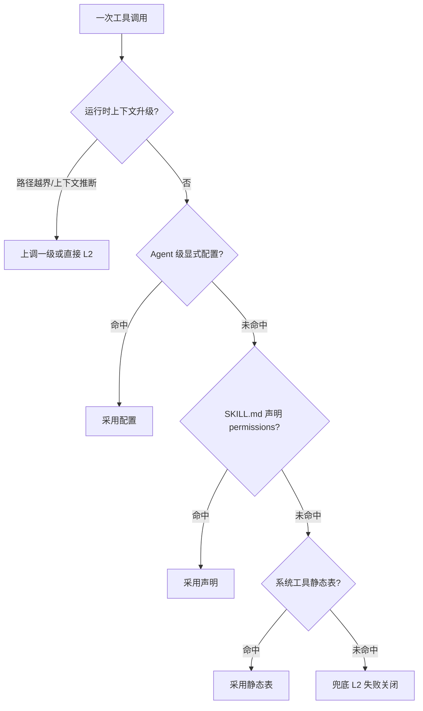
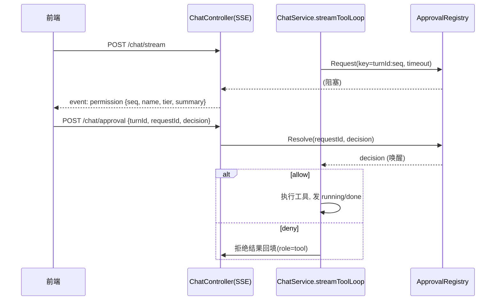

# 工具权限分级设计方案（tool-permission-tiers）

> 状态：**设计稿** · 日期：2026-10-04 · 范围：`cclawservice/harness` 工具循环的工具执行授权
>
> 目标：为 Agent 的工具调用补上一道**权限闸**，按三级授权模型决定"自动放行 / 需用户确认 / 高危审批"：
>
> | 等级 | 名称 | 触发场景 | 处理 |
> |---|---|---|---|
> | **L0** | 只读模式 | 读取/搜索文件（Read/Glob/Grep） | **自动批准** |
> | **L1** | 修改模式 | 创建/修改/覆盖文件（Write/Edit） | **用户确认** |
> | **L2** | 审批模式 | 删除文件、修改环境变量、网络访问、任意命令执行（Bash） | **用户确认 + 高危告警** |
>
> 本文只做设计，不落地实现；文末给出分期落地计划。

---

## 1. 现状与问题

### 1.1 执行链现状（无任何授权环节）

工具调用循环有同步与流式两条实现，均在 `service/chat_service.go`：

- 同步：[chat_service.go:646 runToolLoop](/Volumes/Wisdom/MyIdea/CClaw/src/cclawservice/service/chat_service.go:646)
- 流式：[chat_service.go:705 streamToolLoop](/Volumes/Wisdom/MyIdea/CClaw/src/cclawservice/service/chat_service.go:705)

两条路径在拿到模型返回的 `calls` 后，**无条件**执行：

```go
result, err := execbox.RunScript(ctx, scriptFile, call.Function.Arguments)          // 同步
res, err := execbox.RunScriptStream(ctx, run.script, run.arg, onLine)               // 流式
```

`execbox` 只做**执行护栏**（不走 shell、stdin 传参、超时、输出上限），不做**授权判断**（见 [script_runner.go](/Volumes/Wisdom/MyIdea/CClaw/src/cclawservice/harness/execbox/script_runner.go)）。

### 1.2 工具的两类来源

| 来源 | 判定 | 现状 |
|---|---|---|
| 系统工具 | `hCommon.TSourceSystem`，名称为 `read/glob/grep/write/edit/bash`（见 [harness_tool.go](/Volumes/Wisdom/MyIdea/CClaw/src/cclawservice/harness/common/harness_tool.go:23)） | schema 齐备；当前仅 `read` 有脚本 `bin/cclaw/systemtool/read/scripts/read.py`，其余待实现 |
| 技能工具 | `hCommon.TSourceSkill`，来自 SKILL.md `tools:`，`script:` 指向任意 `python3` 脚本 | 任意代码 = RCE 面（见 `document/技术难点特点/skill执行安全.md`） |

工具经 `tool.FunctionRepository.GetFunctionBundle`（[tool_repository.go](/Volumes/Wisdom/MyIdea/CClaw/src/cclawservice/harness/tool/tool_repository.go:194)）派生成 `FunctionBundle`：

```go
type FunctionBundle struct {
    Tools       []llmproto.Tool   // 下发给 LLM 的 schema
    ForcedNames []string
    Scripts     map[string]string // 工具名 -> 脚本绝对路径
    Slots       []SkillSlot
}
```

**关键缺口**：`FunctionBundle` 中**没有携带任何"这个工具能干什么"的能力/风险元数据**，因此执行层无从判断该不该放行。

### 1.3 已有的可复用机制

| 机制 | 位置 | 复用点 |
|---|---|---|
| SSE 事件通道 | [chat_controller.go:236](/Volumes/Wisdom/MyIdea/CClaw/src/cclawservice/controller/chat_controller.go:236) `emit("tool", ...)` | 新增 `permission` 事件同源下发 |
| 工具事件阶段常量 | [common/constant.go:95](/Volumes/Wisdom/MyIdea/CClaw/src/cclawservice/common/constant.go:95) `ChatToolEvent*` | 新增 `approval` 阶段 |
| 中断注册表 | [turn_stream_mgr.go](/Volumes/Wisdom/MyIdea/CClaw/src/cclawservice/harness/ctxmgr/turn_stream_mgr.go) `TurnStreamRegistry`（key `<sender>:<turnId>`） | 审批等待注册表**照此模式**实现；中断时清理并唤醒 |
| 守卫编排范式 | [chat_tool_guard.go](/Volumes/Wisdom/MyIdea/CClaw/src/cclawservice/harness/security/chat_tool_guard.go) `TurnLoopGuard`（一轮一实例，命中→回填提示） | 审批拒绝同样以"tool 结果回填"而非硬错误收尾 |
| 错误 Kind 注册 | [error_chat.go](/Volumes/Wisdom/MyIdea/CClaw/src/cclawservice/exception/error_chat.go) `apperr.Register` | 新增 `chat.permission_denied` / `chat.approval_timeout` |

---

## 2. 设计目标与原则

1. **单一执法点**：所有工具执行前**必经**权限判定；不在脚本内部、不在 execbox 内部做授权（execbox 保持纯执行器）。
2. **能力（capability）驱动，而非工具名驱动**：以"这个调用会做什么"定级；工具名只是能力声明的载体。
3. **默认拒绝、失败关闭（fail-closed）**：无法判定、超时、断连、非交互渠道 → 一律拒绝。
4. **拒绝是"可对话"的**：拒绝以 tool 结果回填模型（保留 `tool_call_id` 配对），让模型改策略；不用硬错误炸掉整轮。
5. **授权分级 + 会话记忆**：能"仅本次允许"，也能"本会话记住"，减少重复打扰；高危默认不记忆。
6. **与现有护栏正交**：权限闸（能不能做）与 LoopGuard（是否重复做）、Token 预算（上下文）各自独立、互不覆盖。

---

## 3. 权限模型

### 3.1 能力（Capability）—— 原子语义

```go
type Capability string

const (
    CapRead   Capability = "fs.read"   // 读取文件/目录/搜索
    CapWrite  Capability = "fs.write"  // 创建/修改/覆盖
    CapDelete Capability = "fs.delete" // 删除/移动/重命名（含覆盖到不存在目标）
    CapExec   Capability = "exec"      // 执行任意命令/脚本
    CapNet    Capability = "net"       // 网络访问
    CapEnv    Capability = "env"       // 修改环境变量/进程环境
)
```

### 3.2 三级授权（Tier）—— 由能力推导

| Tier | 语义 | 能力集合 | 默认动作 |
|---|---|---|---|
| `L0` read-only | 只读 | 仅 `fs.read` | 自动批准 |
| `L1` write | 修改文件 | 含 `fs.write`，且**不含** `fs.delete/exec/net/env` | 需确认（可"本会话记住"） |
| `L2` approve | 高危 | 含 `fs.delete`、`exec`、`net`、`env` **任一** | 需确认 + 高危告警（默认不记忆） |

> 推导规则：`tier = max(level(c) for c in capabilities)`，且 `level` 顺序为 L0 < L1 < L2。
> 空能力集合（无法判定）→ **L2**（失败关闭）。

### 3.3 定级来源与优先级

定级（`PermissionSpec`）从高到低取值，先命中先定：



1. **运行时上下文升级**（最高优先，覆盖声明）
   - 文件类工具：`file_path` 落在**工作区根**（`<exeDir>/bin/workspace`，见 `read.py` 的 `_workspace_root`）之外 → 读外升 L1、写外升 L2、删任何位置恒 L2。
   - Bash：命令静态分析出的实际能力集**并集**进声明（见 3.4）。
2. **Agent 级配置**：`t_agent` 增加权限模式字段（见 §6.3），支持 `readonly / standard / trusted / custom`。
3. **SKILL.md 声明**（技能工具的唯一可信来源）：在 `tools[]` 的每个工具上新增 `permissions:`（见 §3.5）。
4. **系统工具静态表**（内置常量，见 3.4）。
5. **兜底**：未声明/未知工具 → L2。

### 3.4 系统工具静态表与 Bash 分析

| 工具（归一化名） | 基础能力 | 基础 Tier | 备注 |
|---|---|---|---|
| `read` | `fs.read` | L0 | 越界读 → L1 |
| `glob` | `fs.read` | L0 | 仅列目录，不读内容 |
| `grep` | `fs.read` | L0 | 越界搜 → L1 |
| `write` | `fs.write` | L1 | 越界写 → L2 |
| `edit` | `fs.write` | L1 | 越界改 → L2 |
| `bash` | `exec` | **L2** | 默认 L2；仅当命令通过**严格只读白名单**才可降至 L0 |

**Bash 命令静态分析（best-effort，务必 fail-closed）**

- **降级为 L0 的条件（严进）**：整条命令满足全部：
  - 单条命令，**不含**任何 shell 元字符 `;` `|` `&` `>` `<` `` ` `` `$(` `${` `\n`（含 `&&`/`||`、重定向、命令替换、管道）；
  - 命令名 ∈ 只读白名单：`ls cat head tail wc file stat pwd echo env(无赋值) grep rg find git(status/log/diff/show) which whereis`；
  - 参数中**不含**写/删/nc/curl/wget/ssh 等危险片段。
- **升级为 L2 的关键词**（命中即 L2）：`rm rmdir shred unlink mv dd mkfs chmod chown chgrp kill pkill killall sudo su curl wget nc ncat ssh scp sftp telnet export unset setenv systemctl service python python3 sh bash zsh eval source xargs timeout git push git reset --hard git clean npm install pip install`。
- 其余（含写倾向：`cp mkdir touch tee sed -i`）→ **L1**。
- **分析不明/发生解析歧义 → L2**。

> 局限声明：静态分析无法覆盖 `python -c`、脚本嵌套、别名、编码混淆等。因此 **Bash 的安全底线是 L2 + "L0 只读白名单"这一狭窄降级通道**，不把静态分析当唯一防线；高风险部署应叠加 OS 沙箱（见 `skill执行安全.md` 的 L1/L2）。

### 3.5 技能工具的能力声明（SKILL.md 扩展）

在 `SkillFrontMatter.Tools[]`（`BasicTool`）上新增字段（见 [harness_tool.go BasicTool](/Volumes/Wisdom/MyIdea/CClaw/src/cclawservice/harness/common/harness_tool.go:57)）：

```yaml
tools:
  - name: get_weather
    script: scripts/weather.py
    permissions: [net]            # → L2（网络）
  - name: npa_ingest
    script: scripts/ingest_router.py
    permissions: [fs.read, fs.write]   # → L1
  - name: purge_cache
    script: scripts/purge.py
    permissions: [fs.delete]      # → L2
```

Go 侧：

```go
type BasicTool struct {
    // ... 现有字段
    Permissions []string `json:"permissions,omitempty" yaml:"permissions,omitempty"` // 能力声明
}
```

- 加载时校验：能力字符串 ∈ 已知集合，非法 → 拒绝加载该工具并告警（与现有工具丢弃语义一致）。
- 未声明 `permissions` 的技能工具 → 兜底 **L2**（可配置为 L1，见 §6.3），并在日志打 `permission undeclared` 提醒补声明。

---

## 4. 架构与落点

### 4.1 新增组件

放在现有 `cclawservice/harness/security/` 包内（与 LoopGuard/ProgressGuard 同层，避免新包循环依赖）：

| 文件 | 组件 | 职责 |
|---|---|---|
| `permission_policy.go` | `Capability` / `Tier` / `PermissionSpec` / 静态表 / Bash 分析器 | 纯函数定级，无状态、易测 |
| `permission_gate.go` | `PermissionGate` | 结合 Agent 配置 + 会话授权缓存 + 分类结果，产出 `Decision`（allow / ask / deny） |
| `approval_registry.go` | `ApprovalRegistry`（单例） | 审批请求的等待/唤醒/超时/清理，key `<sender>:<turnId>:<seq>` |
| `permission_grant.go` | `GrantStore`（单例，内存） | 会话级授权记忆（"本会话记住"） |

### 4.2 FunctionBundle 携带权限元数据

定级信息必须**随工具一起**从装配层流到执行层：

```go
// tool/function_bundle
type FunctionBundle struct {
    // ... 现有
    Perms map[string]hCommon.PermissionSpec // 工具名(小写) -> 权限声明
}
```

`collectToolsFromSkill` 在组装每个工具时一并填 `Perms`：系统工具走静态表，技能工具走 front matter 声明。`chatTurn` 透传 `turn.tools.Perms`。

### 4.3 执行前拦截（核心改动点）

**同步路径** `runToolLoop`：

```go
for _, call := range calls {
    spec := resolveSpec(turn, call)                 // 定级
    decision := gate.Check(sender, session, spec)   // allow / ask / deny
    if decision.NeedAsk && !interactive {
        decision = deny(failClosed)
    }
    if decision.Deny {
        messages = append(messages, ctxmgr.BuildToolResultMessage(call.ID, denyResult(decision)))
        continue
    }
    // ... 原执行逻辑
}
```

**流式路径** `streamToolLoop`（关键约束：**同轮多工具并行**）：

1. 收到 `calls`、解析 `runs` 后，**先做一次串行的"权限预检"**，按 `seq` 顺序逐个判定；
2. 需要审批的，发 `permission` SSE 事件并阻塞等待用户回执（**不能并发弹多个对话框**）；
3. 被拒绝的工具标记为 `denied`，**不进入 goroutine 池**；被批准的正常进入并行执行；
4. 由于执行前已逐个确认，后续并行执行的 goroutine 无需再加锁。

> 审批等待发生在 goroutine 池之前，天然串行，避免并发写 SSE（与现有"唯一转发 goroutine"约束一致）。

### 4.4 与 LoopGuard 的关系

- 权限拒绝**不算**工具执行失败，但 LoopGuard 仍会看到"同名工具重复调用"并正常生效；
- 若用户反复拒绝、模型仍反复调用 → LoopGuard 兜底终止，无需额外逻辑；
- 建议：拒绝回填文本里显式提示模型"不要重试该操作，请询问用户"，提高收敛率。

---

## 5. 审批交互协议（流式路径）

### 5.1 新增 SSE 事件 `permission`

服务端 → 前端：

```json
{
  "requestId": "ab12...:7",
  "seq": 7,
  "name": "Bash",
  "tier": "L2",
  "capabilities": ["exec", "fs.delete"],
  "summary": "执行命令：rm -rf build/",
  "preview": "{\"command\":\"rm -rf build/\"}",
  "allowSession": false,
  "expiresInMs": 120000
}
```

前端渲染审批卡片/对话框，提供三个动作：**仅本次允许 / 本会话允许 / 拒绝**。

### 5.2 新增回执端点 `POST /api/chat/approval`

请求体（扩展 `request/chat_model.go`）：

```go
type ChatApprovalRequest struct {
    TurnId    string `json:"turnId"`
    RequestId string `json:"requestId"`
    Decision  string `json:"decision"` // allow_once | allow_session | deny
}
```

- 鉴权同 `/chat/interrupt`：`<sender>:<turnId>` 归属校验，只能操作自己发起的轮次；
- 控制器 → `chatService.ResolveApproval(sender, req)` → `ApprovalRegistry.Resolve`。

### 5.3 等待与决策时序



### 5.4 失败关闭规则（关键）

| 情形 | 行为 |
|---|---|
| 审批超时（默认 120s，可配） | **拒绝**，回填"审批超时"，发 `notice` |
| 客户端断开 / 用户中断 | `ctx.Done()` → 唤醒为拒绝；`ApprovalRegistry.CancelTurn` 清理该 turn 全部待决项 |
| 非流式/非交互渠道（`POST /api/chat`、飞书等） | 无确认通道 → **L1/L2 一律拒绝**（除非命中会话授权或 Agent 显式放行） |
| 未知 `requestId` / 归属不符 | 拒绝 |
| 重复回执 | 幂等：首个决策生效，后续忽略 |
| 一轮结束仍存在待决项 | 清理，防内存泄漏（对齐 `TurnStreamRegistry.Unregister`） |

### 5.5 同步路径的处理

同步 `POST /api/chat` 无法向用户提问，因此：

- L0 → 自动放行；
- L1/L2 → 若命中 `GrantStore`（本会话已授权）或 Agent `trusted`/`auto_approve` 配置 → 放行；否则**拒绝**并在 tool 结果与最终回复里提示"该操作需在流式界面确认"。

---

## 6. 决策、授权与配置

### 6.1 决策引擎

```go
type Decision struct {
    Allow         bool
    NeedApproval  bool
    Tier          Tier
    Spec          PermissionSpec
    Reason        string
    MatchedGrant  bool
}
```

判定顺序：

1. Agent 配置 **deny 列表**命中 → 直接拒绝（最高优先）；
2. Agent 配置 `trusted` 或 `auto_approve` 能力覆盖 → 放行；
3. 命中 `GrantStore`（本会话授权）→ 放行；
4. `tier == L0` → 放行；
5. 交互渠道 → 请求审批；
6. 非交互渠道 → 拒绝（fail-closed）。

### 6.2 会话授权缓存（GrantStore）

- key：`<sender>:<sessionId>`；
- value：授权集合，粒度二选一（建议按能力 + 工具 + 路径作用域）：
  - `(toolName, capabilitySet)`：如"本会话允许所有 `fs.write`"；
  - 更细可记录参数指纹（如 Bash 精确命令、文件路径前缀），减少"一次授权=无限授权"。
- **生命周期**：进程内存，随会话空闲超时/进程重启消失（不做持久化，避免授权越积越大）；
- **L2 记忆策略**：默认**不允许** `allow_session`（仅 `allow_once`）；由 Agent 配置显式开启。

### 6.3 配置来源

1. **Agent 级**（建议落在 `t_agent` 或 agent 配置文件）：
   - `permissionMode`: `readonly` | `standard`(默认) | `trusted` | `custom`；
   - `autoApprove`: 能力白名单（如 `[fs.write]`）；
   - `deny`: 能力/工具黑名单；
   - `approvalTimeoutSec`；
   - `allowSessionForHighRisk`: bool（L2 是否可"本会话记住"）；
   - `undeclaredSkillToolTier`: `L1` | `L2`（默认 L2）。
2. **技能级**：SKILL.md 工具 `permissions:`（§3.5）。
3. **全局默认**：内置常量（当前三级语义）。

配置加载后随 `chatTurn` 传递，权限判定**纯内存**，不额外查库（性能与一致性）。

---

## 7. 工具结果语义（拒绝如何回填）

拒绝必须保留 **`tool_call_id` 配对**（现有注释已强调：缺一条 `role=tool` 会被上游判协议错）。拒绝结果形如：

```json
{
  "denied": true,
  "tier": "L2",
  "capabilities": ["exec", "fs.delete"],
  "reason": "user_denied",
  "message": "用户拒绝了该操作：执行命令 rm -rf build/",
  "hint": "不要重试该操作；请向用户说明并询问替代方案。"
}
```

- 以文本（非 JSON 也可）作为 tool 结果，`recorder.Finish` 正常留痕（`t_turn_tool` 记录到该次调用）；
- 流式路径同时发 `tool` 事件的 `error`/新增 `denied` 阶段，供前端卡片展示。

---

## 8. 数据模型变更

### 8.1 必选（Phase 1）

- 无表结构强制变更（配置可先走代码常量 / agent 配置文件 JSON）。

### 8.2 可选持久化（Phase 3）

- `t_tool` 增加 `permissions`（能力声明，覆盖或补充脚本）与 `risk_tier` 列；或独立 `t_tool_permission` 表；
- `t_turn_tool` 增加 `permission_tier` / `permission_decision` 列，形成**审计轨迹**（谁在何时批准了什么高危操作）；
- 会话授权若需跨进程/重启保留 → `t_session_grant`（建议带 TTL）。

---

## 9. 可观测性

- **决策日志**：`tool=name tier=L2 caps=[exec,net] decision=ask source=config|grant|classifier latency_ms=...`；
- **审批指标**：审批次数、批准/拒绝比、平均等待时长、超时次数（按 Agent/工具聚合）；
- **告警**：Skill 工具未声明 `permissions`（`permission undeclared`）、Bash 分析歧义降级、审批超时率异常；
- **审计**：高危操作（L2）无论批准与否都应落痕（§8.2 列）。

---

## 10. 分期落地计划

### Phase 1 — 系统工具 MVP（只读/写/危险三级打通）

1. 新增 `security/permission_*.go`（分类器 + Gate + Registry + GrantStore）；
2. `FunctionBundle.Perms` 装配（系统工具静态表）；
3. `runToolLoop` / `streamToolLoop` 预检接入（流式串行预检）；
4. SSE `permission` 事件 + `POST /api/chat/approval` + `ResolveApproval`；
5. 前端审批对话框（三动作）与中断/超时兜底；
6. 单测：分类器（含 Bash 白/黑名单）、Gate 决策、Registry 超时/清理、拒绝回填协议配对。

**验收**：Read/Glob/Grep 自动通过；Write/Edit 弹确认；Bash 高危弹告警；超时/断连拒绝；同步路径 L1/L2 默认拒绝。

### Phase 2 — 技能工具与路径作用域

1. SKILL.md `permissions:` 声明 + 加载校验 + 日志提醒；
2. 文件工具工作区作用域判定（越界升级）；
3. Skill 未声明兜底策略与配置开关；
4. 更新现有技能声明（`weather` → `net`；`npa-report` → `fs.read, fs.write`）。

### Phase 3 — 持久化与治理

1. Agent 权限模式配置 UI/接口；
2. `t_turn_tool` 审计列 / `t_session_grant`；
3. Bash 分析增强 + 与 OS 沙箱（`skill执行安全.md` 的 L1/L2）联动：高危技能默认套沙箱，声明与沙箱双重约束。

---

## 11. 风险与边界

| 风险 | 说明 | 缓解 |
|---|---|---|
| Bash 静态分析可绕过 | `python -c`、嵌套脚本、混淆 | Bash 恒 L2；只读降级走极窄白名单；叠加沙箱 |
| 声明是信任边界 | 技能脚本声明 `fs.read` 但实际写盘 | 技能作者视为可信（管理员代码）；第三方技能必须沙箱 |
| 审批阻断交互 | 长任务频繁弹窗、等待拖慢体验 | 分级记忆（L1 可 session）；同类批量；心跳保活（已有） |
| 并行工具多弹窗 | 同轮多个 L1/L2 | **串行预检**（§4.3），逐个确认 |
| 超时与运行预算关系 | 审批等待占用 `AgentRunTimeout`(600s) | 审批等待**独立计时**，不计入工具执行预算；超时即拒绝 |
| 授权粒度 | "本会话记住"可能过度授权 | 默认按 (工具, 能力, 作用域)；L2 默认不记忆 |
| 非交互渠道 | 飞书等无法确认 | fail-closed 拒绝 + 明确提示改用流式界面 |

---

## 12. 关键改动清单（供实现时对照）

| 类型 | 文件 | 改动 |
|---|---|---|
| 新增 | `cclawservice/harness/security/permission_policy.go` | 能力/等级/静态表/Bash 分析 |
| 新增 | `cclawservice/harness/security/permission_gate.go` | 决策引擎 |
| 新增 | `cclawservice/harness/security/approval_registry.go` | 审批等待注册表 |
| 新增 | `cclawservice/harness/security/permission_grant.go` | 会话授权缓存 |
| 改 | `harness/common/harness_tool.go` | `BasicTool.Permissions`；`SystemToolName` 静态表 |
| 改 | `harness/tool/tool_repository.go` | `FunctionBundle.Perms` 装配 |
| 改 | `service/chat_service.go` | 两条循环的预检；`ResolveApproval` |
| 改 | `controller/chat_controller.go` | `permission` 事件；`ApprovalChat` 端点 |
| 改 | `request/chat_model.go` | `ChatApprovalRequest` |
| 改 | `common/constant.go` | 事件阶段常量 |
| 改 | `exception/error_chat.go` | `chat.permission_denied` / `chat.approval_timeout` |
| 改 | `cclawchat/scripts/modules/{stream,api,chat}.js` | 审批事件处理 + 回执 |
| 改 | `bin/cclaw/systemtool/*/*.json`、SKILL.md | 能力声明（Phase 2） |
