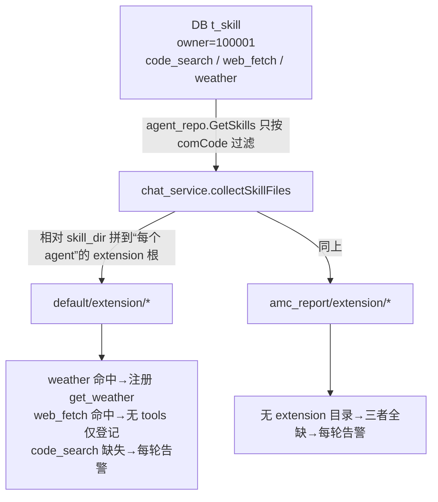
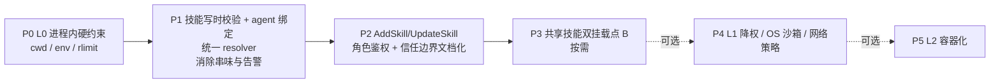

# Skill 信任边界与归属范围设计（skill-trust-and-scope）

> 状态：**设计稿** · 日期：2026-09-04 · 范围：`cclawservice` 的 ScriptRunner 执行安全 + `t_skill` 归属/解析语义
>
> 本文档对齐两份需求：
> 1. **ScriptRunner**：无 shell / stdin 传参 / 超时与输出入参上限 / 路径限制在 extension 根内 —— 已做得不错；但脚本以服务进程权限运行，无用户隔离/沙箱，python 可访问网络与本机文件。
> 2. **t_skill 归属**："公司级共用 + 相对路径解析到各 agent extension 根" → 同一 `code_search/web_fetch/weather` 会解析到每个 agent 的 extension 下（`default` 命中、`amc_report` 全缺并打告警），语义混乱且误配会"技能跨 agent 串味"。

---

## 1. 现状与事实（含代码证据）

### 1.1 ScriptRunner（`cclawservice/service/runtime/scriptrunner/script_runner.go`）

**已做（护栏）**：

| 护栏 | 实现 |
|---|---|
| 不走 shell | `exec.CommandContext(policy.Bin, scriptPath)`，解释器直启，无 `/bin/sh -c` |
| 参数经 stdin | 参数 JSON 写 `cmd.Stdin`，避开 argv 长度/转义/注入 |
| 超时 | `DefaultScriptPolicy`：15s（`context.WithTimeout`） |
| 输出上限 | stdout / stderr 各 256KB（`limitedBuffer`），流式路径另有单行上限 |
| 入参上限 | args JSON ≤ 64KB |
| 路径限制 | `runtime/toolset.go::resolveScriptPath` → `SafeJoinExisting` 强制脚本落在 extension 根内；绝对路径脚本直接拒绝 |

**缺口**：

| 缺口 | 说明 |
|---|---|
| 无进程级资源约束 | 未设 `cmd.Dir`（继承服务 cwd）、未控 `cmd.Env`（继承服务全量环境变量，可能含密钥/PATH）、无 `setrlimit`（CPU/内存/句柄/子进程数无上限） |
| 无权限降级/沙箱 | 以 cclawservice 进程 OS 用户运行；python 可联网（`weather.py` 即 urllib 请求 Open-Meteo）、可读写 extension 根外任意文件、可派生进程 |
| 无网络策略 | 无 deny-by-default / 按需放行 |
| 信任模型全有或全无 | `SKILL.md + scripts` 本质 = **以服务权限执行的任意代码（RCE 面）**；路径校验只约束"脚本从哪来"，不约束"脚本能干什么" |

### 1.2 t_skill 归属与解析（`t_skill` 表 / `TSkill` / 三条加载链路）

**数据模型**（`data/ddl_sqlite3.sql` + `model/dataobject/t_agent.go`）：
- `t_skill` 只有 `owner_id`（= comCode）+ `skill_scope`（系统/个人/项目/插件），**没有 agent 维度**；
- `skill_scope` 目前只用于 UI 展示（`cclawchat/.../home.js` `SKILL_SCOPE_LABELS`），**不参与任何绑定/过滤逻辑**；
- `skill_dir` 存的是相对路径，但**相对基准没有统一定义**。

**三条链路的语义冲突**：

| 代码点 | 行为 | 问题 |
|---|---|---|
| `model/repo/agent_repo.go::GetSkills(comCode)` | 只按 `OwnerId==comCode` 过滤 | 该租户**所有 agent 继承同一批技能**，无 agent 维度 |
| `service/chat_service.go::collectSkillFiles` | 相对 `skill_dir` 逐个拼到**每个 agent** 的 `BuildAgentExtensionRoot()`（=`<exeDir>/cclaw/<owner>/<agentDir>/extension`） | 同一行被多 agent 重复解析；命中靠物理目录碰巧存在 |
| `model/repo/prompt_repo.go::resolveSkillPathLocked` | 注释：相对路径相对**工作区根（bootstrap root）**；且允许位于工作区之外的共享目录 | 与 collectSkillFiles（相对 **extension root**）是**两套基准**，历史遗留，靠"上层先转绝对路径"才不打架 |

**症状（日志实证）**：每轮会话 `skill file not found` 告警，如
`.../default/extension/code_search/SKILL.md`、`.../amc_report/code_search/SKILL.md`、`.../amc_report/web_fetch/SKILL.md`（`bin/log/2026*.log`）。

**根因一句话**：数据模型表达不了"技能归哪个 agent / 哪个物理目录"，却用 owner 级共享 + per-agent 相对解析的混合语义去解释它 → 命中靠运气、缺文件靠告警、误配会串味。

---

## 2. 设计原则

1. **定点解析，不做碰运气解析**：技能的"归属（owner/agent/scope）"与"物理位置"在**写入时**确定并校验；读取时只解析绑定到**当前 agent** 的那部分，不再"逐 agent 全量解析再过滤"。
2. **单点解析基准**：所有层共用**一个** resolver，消灭"bootstrap root vs extension root"两套基准并存。
3. **信任边界明确、写入点执法**：可执行 SKILL = 管理员可信代码；新增/修改 executable skill 的入口必须鉴权并校验路径落点。
4. **分层加固、按需升级**：进程内硬约束（必做）→ OS 降权/沙箱（按部署形态）→ 容器化（远期可选）。

---

## 3. 方案

### 3.1 问题 1：ScriptRunner 信任边界（分层）

#### L0 — 进程内硬约束（改动最小，建议必做）

| 措施 | 做法 | 解决什么 |
|---|---|---|
| 固定工作目录 | `cmd.Dir = <该工具 extension 子目录或只读工作区>` | 消除对服务 cwd 的隐式依赖/相对读 |
| 环境变量白名单 | `cmd.Env` 只放最小 `PATH` + 显式变量，不继承服务 env | 防脚本读环境里的密钥/配置（`requires.env/config` 必须显式声明 + 注入，绝不自动透传） |
| 资源上限 | 起进程前 `setrlimit`（CPU / AS / NOFILE / NPROC / FSIZE），Linux/macOS 均可 | 防死循环占满 CPU、内存打爆、fork 炸弹、写爆磁盘 |
| 超时细化 | 保留 15s 兜底，允许按 SKILL.md 声明覆盖 | 与 `ScriptPolicy` 现有可定制字段对齐 |

收口点：`runScriptWithPolicy` / `RunScriptStream`（两处共用）。

#### L1 — 进程外降权 / OS 沙箱（可选，按部署形态）

- **权限降级**：服务以 root/特权用户运行时，脚本以专用低权用户（如 `cclaw-skill`）exec，先 `Setuid/Setgid` 再起 python；`Home` 指向只读空目录。
- **系统沙箱**：macOS `sandbox-exec`（deny network 的 profile）、Linux `bubblewrap`/`firejail`；作为"非受信技能默认套上、高受信技能豁免"的开关。
- **网络策略**：默认按 SKILL.md 是否声明 `requires.network` 决定放行/拦截（L0 拦不住网络，这一层才真拦得住）。

#### L2 — 容器化（远期可选）

per-skill 镜像 / gVisor，只对高风险或第三方技能启用。多租户本地部署中大部分技能为自家管理员编写，**不推荐一上来全量容器化**。

### 3.2 问题 2：技能归属与解析（选项 + 建议）

#### 选项 A —— 最小语义修正（推荐先做）

1. 给 `t_skill` 增加绑定维度（二选一）：
   - **A1**：加 `agent_id` 列，该行只绑定一个 agent（个人/插件类）；
   - **A2**：复用 `skill_scope` 划分：`系统/项目`=owner 共享、`个人/插件`=per-agent（仍需加 agent 绑定字段）。
2. **统一解析基准**：抽 `common::ResolveSkillPath(owner, agentDir, scope, skillDir)`，`chat_service.collectSkillFiles` 与 `prompt_repo.resolveSkillPathLocked` **全部改走它**。
3. **写时校验**：`repo.AddSkill/UpdateSkill` 内解析 + `EvalSymlinks`，校验必须落在"该 agent 的 extension 根 / owner 共享根"内，否则直接报错，不再等到每次聊天打告警。
4. **读时定点**：`collectSkillFiles` 只解析绑定到**当前 agent** 的技能（owner 共享类走共享根）。

- 优点：数据结构小改、语义立刻自洽、日志噪音消失。
- 缺点：需要一次数据迁移（为已有 3 行补 `agent_id`，默认给 `default`）。

#### 选项 B —— 显式双挂载点（若确有"公司级共享技能"诉求）

物理目录与 DB 一并分两类：

| 类别 | scope | 物理挂载点 | agent 绑定 |
|---|---|---|---|
| owner 共享 | `系统`/`项目` | `<exeDir>/cclaw/_shared/extension/`（owner 级一个根，不逐 agent 复制） | 无，解析一次 |
| agent 私有 | `个人`/`插件` | `<exeDir>/cclaw/<owner>/<agentDir>/extension/`（现有布局） | 必须 `agent_id` |

- 命名冲突校验：按 `(owner, scope 归属, agent/共享根)` 三键唯一，防"同名技能两个根都存在"。
- 优点：语义最干净，支持"一份脚本多 agent 复用"（当前注释想表达但未实现的能力）。
- 缺点：改动最大，含目录规范 + 数据迁移 + 前后端字段。

#### 选项 C —— 存解析后的绝对路径（不建议单独用）

写入时 `EvalSymlinks` 成绝对路径存库（`prompt_repo` 注释"DB 管理员可配绝对路径"已预留此口）。读取 = 纯存在性检查。
缺点：路径含 `<exeDir>`，部署目录一变全表失效，可移植性差。只建议作为 B 的"已解析缓存"，而非主存储。

#### 建议

- **A 先落地止血**（统一 resolver + agent 绑定 + 写时校验）→ **B 作为下一阶段目标**；C 只在缓存层用。
- 无论 A/B 都补：
  - `GetSkills` 改为返回"当前 agent 可用技能集"（现在把 owner 全量往下扔是噪音源头）；
  - 管理端展示"绑定 agent / scope / 解析预览（解析到哪个绝对路径）"（前端 `home.js` 已有 scope 标签，缺 agent 列与路径预览）。

---

## 4. 信任边界文档化 + 写入口治理（两问题共用）

写入 `cclawservice/config/agentconfig.md` 或仓库根 `readme.md`：

1. **信任模型一句话**：`SKILL.md + scripts = 管理员可信代码`；执行 = 服务进程权限；`front matter.tools` 声明的任何脚本都是潜在 RCE 面。
2. **写权限**：仅管理员角色可 Add/Update 技能；普通登录用户不得写入可执行技能。当前 `controller/agent_controller.go::AddSkill/UpdateSkill` **只验证登录态、无角色校验** → 需补。
3. **评审/审计**：新增/变更 executable skill 视为提交代码，走与代码同等的 review；`requires.env/config` 中的密钥不落 SKILL.md、不自动注入。
4. **沙箱开关**：配置项声明默认策略（L0 全开；L1/L2 是否启用、哪些 skill 豁免），并写明"非受信技能必须沙箱内运行"。

---

## 5. 落地 Roadmap

| 阶段 | 内容 | 依赖 | 触发条件 |
|---|---|---|---|
| P0 | L0 进程内硬约束 | 无 | 建议直接并进主流程，风险最低 |
| P1 | 技能写时校验 + agent 绑定 + 统一 resolver | 无 | 本次讨论的主目标 |
| P2 | 写入口角色鉴权 + 信任边界文档化 | 可与 P1 同批或紧随 | 信任边界的执法点 |
| P3 | 共享技能双挂载点（选项 B） | P1 | 出现"多 agent 复用同一脚本"诉求 |
| P4 | L1 降权 / OS 沙箱 / 网络策略 | 部署形态确认 | 接第三方技能 / 安全合规要求 |
| P5 | L2 容器化 | P4 | 高风险 / 外部技能规模化 |

---

## 6. 待确认事项

- [ ] `t_skill` 现有 3 行（code_search / web_fetch / weather）的 `agent_id` 归属（默认给 `default`？`code_search` 物理缺失如何处理——补文件还是删行？）
- [ ] 是否确有"公司级共享技能"诉求 → 决定是否走选项 B 的双挂载点
- [ ] L1/L2 是否需要（部署是否为多租户/特权用户/第三方技能）
- [ ] 服务 OS 用户与目录权限现状（`bin/cclaw/...` 是否可被低权用户只读）
