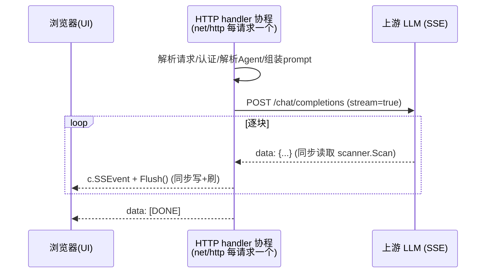
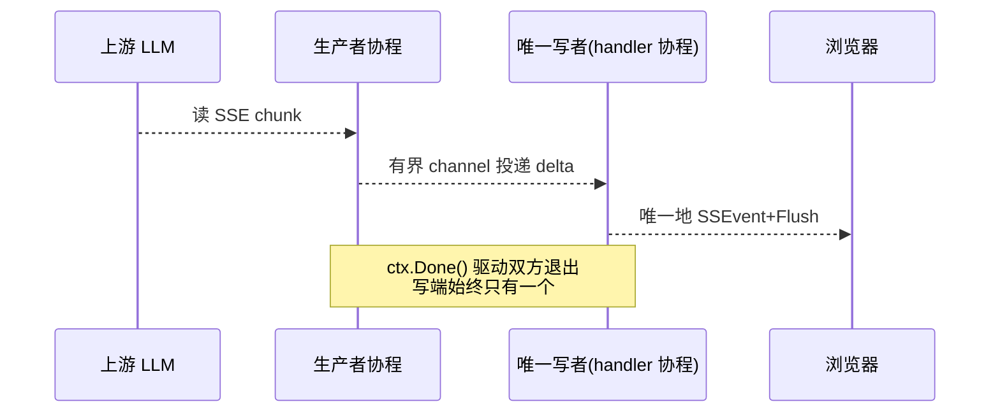

# LLM 配置信息

    主流厂商 context window 一览
    DeepSeek（官网数据）
    模型	Context Length	最大输出
    deepseek-v4-flash	1M (100万)	384K
    deepseek-v4-pro	1M (100万)	384K
    deepseek-v4-flash-vision-exp	1M (100万)	384K
    deepseek-v3 / v3.1 / v3.2 / r1（旧）	128K	—
    Qwen 通义千问（阿里云百炼）
    模型	上下文窗口
    qwen3.8-max / qwen3.7-max	1M
    qwen3.7-plus / qwen3.7-flash	1M
    qwen3-coder-plus / coder-flash	1M
    qwen-long（超长文本专用）	10M (1000万)
    qwen-turbo / qwq-plus	128K
    qwen3 系列开源版	128K~256K
    GLM 智谱（开放平台 + 百炼三方）
    模型	上下文窗口	最大输出
    GLM-4-Plus	128K	4K
    GLM-4-Air-250414	128K	16K
    GLM-4-AirX	8K（低延迟版，注意偏小）	4K
    GLM-4-Flash-250414 / FlashX	128K	16K
    glm-5.2（最新，百炼）	1M	—
    glm-5 / 5.1 / 4.7	198K	—
    glm-4.5	128K	—
    Kimi（月之暗面）& MiniMax
    模型	上下文窗口
    kimi-k2.7-code	256K
    kimi-k2.5 / k2-thinking	256K
    MiniMax-M3	192K
    mimo-v2.5-pro	1M
    MiniMax-M2.7 / M2.5 / M2.1	192K / 200K

# 项目简介

## 1. done

- 生成SSL所需的cert/key文件命令：(open command line with Administrator)
  - 生成CA私钥
    openssl genrsa -out ca.key 2048 //生成CA私钥
  - 生成CA根证书
    openssl req -x509 -new -nodes -key ca.key -sha256 -days 3650 -out ca.crt -subj "/C=CN/ST=Beijing/L=Beijing/O=Dev/CN=Local CA"
  - 生成服务器私钥
    openssl genrsa -out server.key 2048
  - 生成CSR（不包含SAN）
    openssl req -new -key server.key -out server.csr  -subj "/C=CN/ST=Beijing/L=Beijing/O=Dev/CN=localhost"
    - 使用CA签署，同时添加SAN
      - 创建server.cnf文件，其文件内容：
        [req]
        default_bits = 2048
        prompt = no
        default_md = sha256
        distinguished_name = dn
        req_extensions = v3_req

        [dn]
        C = CN
        ST = Beijing
        L = Beijing
        O = Dev
        CN = localhost
      
        [v3_req]
        keyUsage = keyEncipherment, digitalSignature
        extendedKeyUsage = serverAuth
        subjectAltName = @alt_names
      
        [alt_names]
        DNS.1 = localhost
        DNS.2 = *.localhost
        IP.1 = 127.0.0.1
        IP.2 = ::1
      - 执行1：
        openssl req -new -key server.key -out server.csr -config server.cnf
      - 执行2：
        openssl x509 -req -in server.csr -CA ca.crt -CAkey ca.key -CAcreateserial -out server.crt -days 365 -sha256 -extensions v3_req -extfile server.cnf
  - 验证证书
    openssl x509 -in server.crt -text -noout | findstr "Subject Alternative Name"
  - 添加证书
    certutil -addstore "Root" ca.crt
    

- 基于sql.DB, gorm.DB进行数据库操作，实现分离
- 设置当前工作目录为 -- D:/MyIdea/CClaw/src
- 重新生成swagger文档
  - cd D:/MyIdea/CClaw/src/agentService
  - swag fmt ## 清空缓存
  - swag init -d .,./../platformutility,./../cclawservice --parseInternal --parseDependency --parseDependency ## 生成swagger文档

- Session相关
  - 通过SessionId(string) 唯一标识
  - 比如在chat.deepseek.com或类似的聊天AI聊天平台上点击“开启新对话”或新建聊条，就表示一个新的Session开始
  - 一个Session下会有聊天记录，通过聊天历史进行管理
  
- 聊天历史
  - 有很多message构成，每个message通过messageId进行标识
  - 每个message有方向，即用户的问题，与AI的回复

## 2 本系统agent设计机制
- 确定 RootDir = filepath.Join(GetExecutableDir(),"/bin")
- 确定系统的工作目录，skill目录，session目录，memory目录等
- skill的目录应该有系统的skill目录，个人的skill目录，项目的skill目录三种；
  - 个人的skill目录应该是：{RootDir}/{person_}/{agent}/skill
  - 项目的skill：{rootDir}/{project_name}/{agent}/skill
- session 目录依赖于skill目录，即/workspace/skill/{session_name}/***
- memory目录依赖于session:workspace/skill/{session_name}/{memory_date}

## 3 Agent启动文件读取的时机和机制
### 1. 应用启动时（预热,首次读）
AGENTS.md,SOUL.md等启动文件的真正读取的点是PromptRepository.LoadWorkspace() -> 内部循环 -> readAgentDocumentLocked()。读取启动
文件有两个触发时机，且因为指纹缓存，绝大多数情况下并不会真的读盘。即进程启动时，应该将default agent给读取进来

- AGENTS.md: 
  - 职能：作业手册
  - 业务类比：岗位职责 + 作业制度
  - 内容定位：绘画启动流程、任务处理SOP、工具/记忆规则、安全与合规红线、输出规范；
- SOUL.md:
  - 职能：人格/价值观
  - 业务类比：职业准则
  - 内容定位：不良资产专家人设、职业道德（客观/审慎/保密）、沟通风格
- IDENTITY.md
  - 职能：身份名片
  - 业务类比：工牌
  - 内容定位：名称、emoj、头像、对外简介、版本
- USER.md
  - 职能：用户画像
  - 业务类比：客户档案
  - 内容定位：服务对象岗位/机构、术语表、项目经验、决策记录
- MEMORY.md
  - 职能：长期记忆
  - 业务类比：知识库/工作日志
  - 内容定位：各自技能用法 + 业务场景示例 + 合规提示
- TOOLS.md：
  - 职能：记录在“在哪里/用什么、模版放哪里”
  - 业务类比：工具清单、本地资源地图
  - 内容定位：记录目录、模版、命名习惯、工具清单、本地资源地图等；但并不定义具体的工具，实际的工具定义还是在SKILL.md中,在TOOLS.md中对这些TOOL进行引用

建议原则：
  流程规则 进 AGENT.md；价值观 进 SOUL.md；事实与记忆 进 MEMORY.md；两者不重复；当前 AGENTS.md 里 “人格/语气”类内容应下方或删除。就是说能力在SKILLS.md，
  TOOLS.md只是记住“有哪些能力、资源在哪里”的备忘。

### 2. 每次组装时
这里才是读取agent启动文件的主路径，且按需读取。PromptService.BuildSystemPromptEx()第一步：
  if err := service.promptRepo.LoadWorkspace(workspaceRoot)
这才是业务的主入口 -- 当一次会话需要构建system prompt时，才会走到这里。其函数LoadWorkspace()函数有一道短路行为，基本上直接读取缓存即可实现

所有的Agent是在系统启动时就会全部加载；
Agent的配置信息是放在数据库中的

这里的短路行为是通过对agent的启动文件的进行修改指纹计算（即filename+size+mtime）对7个启动文件进行计算，只要有一个修改了以及换了工作区，就重新读取

### 3.读取SKILL.md
读取SKILL.md的时机与agent启动文件是不同的，SKILL.md只是在每次BuildSystemPromptEx()都会ClearSkills后重新读取；由于skill文件路径由调用方
作为参数传入，由于数量较少，直接读取即可

### 4. 压缩机制
放入到system prompt中并非md文件的所有内容，AGENTS.md/SOUL.md等启动文件进入system prompt前，会经过一条“受控快照”处理管线：
  - 剥离front matter
    在md文件中以"---"包裹的部分为metadata，不会进入到prompt，metadata部分是用来与用户的意图进行判断使用的
  - 按文件预算截断
    单文件默认上限：bootstrap.md上限为20,000字节；user.md上限为4,000字节
    超限的话用trimBootstrapContent截断，并留下可读标记让模型知道内容不完整
    AGENTS.md有专门的trimAgentBootstrapContent（生成policy digest摘要）
  - 按总量预算压缩（最重要）
    
     不是每个文件各自为政，而是按顺序累加一个总盘子：
     const totalMaxChars = opts?.totalMaxChars ?? DEFAULT_BOOTSTRAP_TOTAL_MAX_CHARS; // 60000
     let remainingTotalChars = totalMaxChars;
     for (const file of files) {
     if (remainingTotalChars <= 0) break;          // 预算耗尽，后面文件直接不注入
     const fileMaxChars = Math.min(fileBudget, remainingTotalChars);
     ...
     }
     
    raw = 磁盘原文的长度，injected = 实际进入到prompt的长度；只有文件足够小、总量够用时两者才想等。
  - 缺失/空白处理
    - 空白或纯空白内容 -> 整个跳过 （skips empty or whitespace-only content）
    - 必须文件缺失- > [MISSING] Expected at: /path/AGENTS.md标记
  
  - 按会话范围过滤
  - 最后以阅读指引的Project Context节注入

### 5. 总结
  AGENTS.md/SOUL.md等并不是整个md原文进入到system prompt，而是经过“剥离front matter -> 每文件 20K/USER 4K -> 总量 60K预算截断 -> 缺失/空白处理
  -> 按会话处理范围过滤”后的受控快照；切在OpenClaw/Codex里还会进一步按文件语义分流（规则->Project Context、人格->指令通道、记忆->工具、技能->目录）,
  并附上截断警告与“怎么用这份文件”的阅读指引。

  而在当前项目中实现的：
  SplitFrontMatter只注入Content正文中
  MaxBootstrapFileChars = 20000 / MaxUserDocChars = 4000
  MaxBootstrapTotalChars = 60000 + enforceTotalBudget
  [MISSING] Expected at: <path>
  
  Bootstrap Context Notice 
  isKindAllowedInScope（subagent仅AGENTS、corn无MEMORY)
  skill只注入metadata

## 4. front matter机制
  front matter的本质：它是可选的、用来把metadata和正文给分割开来，而不是进入到system prompt的闸门。若无front matter判断机制则非常简单
  front matter只是负责切分，并不负责把关

### 1 判断正文是什么 <- front matter只影响这一步

  首行是"---" 且有闭合的"---"行，有front matter， "---"包裹的之间的YAML元数据剥离，只取后面的正文 进入到prompt的正文
  首行不是"---"则就是普通的md, 无front matter，整个md就是正文，进入到prompt正文的候选区
  首行是"---"无闭合的"---"，视为普通的md, 整个md就是正文,进度到prompt正文的候选区，不判断为front matter

### 2 正文能否进入/进入多少到system prompt 
  <- 由预算/空白/缺失/范围决定，与front matter无关
  最终决定哪些内容进步到system prompt中的判断依据是：
  - 有front matter的就取body部分，没有的就取整个文件内容
  - 然后经过：空白->预算->范围-> 三道过滤，剩下的才是真正放入到system prompt中的内容

对于启动文件来说，没有front matter时整个文件内容放入到system prompt反而是期望行为，因为AGENTS.md/SOUL.md本质就是“要喂给模型的指令”，用户写的
多长、写什么，就该让模型看到什么（只要不超预算）。

## 5 多Agent支持时
### 1. 以agents形式提供给UI
  多agent的“名单”不是前端写死的，而是在数据库中配置，通过UI界面面向用户提供管理管理功能。系统将以getAgents形式提供agents列表功能。

### 2. 有后端服务决定“谁是默认、是否必须让用户选择”
  表t_agent配置default字段，表示是否有默认的agent，而OpenClaw中通过defaultId,ownership,selectionRequired这三个字段决定了用户的行为
  单个agent不显式选择器，多个agent且无default时且selectionRequired则强制用户选择。

### 3. UI端的agent数据来源
  面向用户选择了agent时，应向用户显示agent的identity（姓名/emoj/头像）和默认模型、runtime.

  OpenClaw的“多agent+UI聊天”本质是一条“配置 -> agents列表 -> 选择器 -> selection状态 -> session key -> chat.send -> 网关按惰性
  加载并运行”

## 6 session管理
### 1. 把“选中的agent”变成会话上下文（session key）
选中agent后，前端要将这个这个选择“钉”进会话。先选择agent，再选择session（顺序保证订阅者只看到一次有序状态迁移），如OpenClaw的ts代码

    export function selectApplicationSession(params) : void {
      const agentId = params.agentId.trim() || parseAgentSessionKey(params.sessionKey)?.agentId
      if (agentId) {
        params.selection.set(normalizeAgentId(agentId)) // 更新agentSelection
      }
      params.gateway.setSessionKey(params.sessionKey) //更新当前的session key
    }
  
    New Session后，则跳到聊天页面：
    async navigate(context,started){
      selectionApplicationSession({
        selection:context.agentSelection,
        gateway:context.gateway,
        sessionKey:started.key, //
        agentId:started.agentId
      })
    }

## 7 ChatStream的goroutine处理

### 1、先澄清现状：当前其实已经是「每请求单 goroutine」

我全仓检索过 chat 链路，`ChatStream` 这条路径**没有额外开任何 goroutine**（无 `go func`、无 `make(chan)`）。实际执行模型是：

Go 的 `net/http` 为每个请求分配一个 goroutine，`ChatStream` 的整个「读上游 → 写浏览器 → Flush」循环都在**这一个请求 goroutine 里同步完成**；`onChunk`/`onStatus` 是在 `bufio.Scanner` 的读循环里**同步回调**的。所以实时展示**已经是单 goroutine**，没有并发写、没有共享状态。

### 2、回答：对当前场景，保持单 goroutine 就是最优解，不建议拆

对「纯 SSE 转发」这种场景，单 goroutine（请求协程）天然正确：

1. **无数据竞争**：唯一写响应者，SSE 事件顺序、时序天然正确；若拆成多 goroutine 并发 `c.SSEvent/Flush`，`ResponseWriter` 并发写是**竞态**，会乱序甚至损坏 SSE。
2. **天然背压**：客户端慢 → socket 写缓冲满 → 写阻塞 → 上游读自然变慢，内存不会无限增长；拆开反而要手动做有界 channel 才不至于 OOM。
3. **生命周期简单**：客户端断开/取消 → `ctx` 取消 → 读循环退出 → handler 返回，**无 goroutine 泄漏**；拆开需要自己管理「生产者在 ctx 取消时退出」「close-once 语义」。
4. **持有请求协程不是问题**：每个连接本就独占一个协程，长时间占用不阻塞其它请求（不像某些框架的线程池会耗尽）。

### 3、什么情况下才值得拆成「生产者/消费者」多 goroutine

如果只是现在这样「转发文本」，**不要拆**。只有当未来出现以下需求时再演进：

1. **工具调用 / Agent 多步循环**：在等待下一个 chunk 的同时去执行工具（web_fetch、查库、并行子任务）并聚合，这时「上游读取」和「其余工作」确实需要并发。
2. **流式期间的旁路任务**：心跳、指标上报、超时看门狗等。

届时建议的形态（而非随意开 goroutine）：

关键约束：**写响应只能有一个协程**（channel 汇聚到唯一写者），生产者负责读上游+投递，channel 必须有界，双方都监听 `ctx.Done()` 防泄漏。

### 4、结论与建议

- **现在不用改**：当前单 goroutine 泵是正确的、最简的实现，实时展示已经完全满足（每块到达即 `Flush` 到浏览器）。
- **UI 若感觉「不够实时」**，瓶颈不在并发模型，而在两点：①首 token 延迟（TTFB）——等待期我们已发 `status: thinking` 占位；②逐块 flush 已做到，无需改动。
- **等做「工具调用循环」时**，再按上面的生产者/消费者结构演进，并把「上游读取」抽成可注入的组件，其它逻辑（写端、错误、取消）保持不变。

需要的话，将来落地工具调用时我可以按这个结构来设计，届时再把这段分析沉淀到 repo memory。

## 8 function calling
### 1 机制和原理
  从代码上来看，function calling实际上只是将tools的信息构建成请求并发送给大模型，这些tools信息来自于toolset.go中的LoadToolSet函数中，将SKILL.md文件中的内容
  给加载进来，
  LLM之所以能做的到function calling，本质上是因为：
- 本质：模型只是“声明意图”，并不执行
  function calling 在底层不是一种让模型链接到外部的系统机制，而是：模型把“工具定义”当作可用的动作清单，在需要外部信息或执行动作时，以概率生成一段特殊结构的文本 ---
  内容是“我要调用***函数，参数是***”。然后你的运行时(本项目是：ChatService.go的ToolSet.Exec)解析这段文本、真正执行、把结果回填。
  模型 -> 意图文本 -> 运行时 -> 真实结果，中间隔着的是 业务代码。
- 为何“只发schema”就够？ --- 推理与训练
  训练侧：模型在预训练/后训练时，喂入了大量形如（对话历史 + 工具定义  -> tool_use输出 -> 工具结果 -> 最终回答）的样本。模型学习到的是：当对话里出现 tools 清单、
  且任务需要外部信息时，应该输出tool_use格式的token序列，而不是继续应答。
  
  推理侧：LLM本质上是next-token预测器。请求里的tools会被当作普通上下文token注入；当模型“觉得”该调用工具时，它在此表中选出一个特殊的控制token（如tool_use起始token）,
  然后按约束继续生成函数名和参数。整个过程和写一段回答没区别 -- 只是格式被约束定成了结构化的JSON。
  - 协议层：三个关键段
    - 请求段（生成请求）BuildChatCompletionRequestWithTool函数的作用
  
          {
            "model": "qwen3-8b",
            "messages": [ {"role":"system","content":"..."}, {"role":"user","content":"请查询杭州市天气"} ],
            "tools": [{
              "type": "function",
              "function": {
                "name": "get_weather",
                "description": "查询指定城市实时天气与未来三天预报…",
                "parameters": {            // ← JSON Schema
                  "type": "object",
                  "properties": { "city": { "type": "string", "description": "城市名称…" } },
                  "required": ["city"]
                }
              }
            }]
          }
      这个正是toolset.go从SKILL.md解析出来的Tool -> llm_message.go的Tools
    - 响应段：模型返回的tool_calls

          {
            "choices": [{
              "message": {
                "role": "assistant",
                "content": null,                        // ← 没有正文
                "tool_calls": [{
                  "id": "call_abc123",
                  "type": "function",
                  "function": {
                    "name": "get_weather",
                    "arguments": "{\"city\": \"杭州市\"}"   // ← 注意:这是字符串,需要你 json.Unmarshal
                  }
                }]
              }
            }]
          }
      两个关键点：1.arguments是字符串形式的JSON，非对象，需要应用层自己解析；2.content为null说明模型这一轮“只是调用工具不回答”
    - 回填段：tool角色消息
      执行完脚本后，把结果原样拼回对话历史，用tool_call_id关联到刚才那次调用：
      { "role": "tool", "tool_call_id": "call_abc123", "content": "{\"city\":\"杭州市\",\"current\":{...}}" } -> 本项目的示例
      对应到llm_message.go的ToolResultMessage(callId,content)。注意：messages必须严格交替为带上执行结果，否则模型会困惑。
### 2 为什么必须“工具循环”（agent loop）
  因为模型一次只能表达一步意图，而是“看到结果再决定下一步”是多轮推理：
  streamToolLoop/runToolLoop里的 for i = 0 ; i < AgentToolLoopMax; i++就是干这个的：
  - 模型要工具 -> 你的系统执行 -> 回填 -> 再问一次；
  - 模型不再要工具、给出正文 -> 跳出循环，把正文挡最终回答

### 3 流式下的tool_calls分片（代码中的toolCallAccumulator的原因）
  流式时模型按token增量输出，tool_calls会被index拆成多片
  
    // 第 1 片
    {"choices":[{"delta":{"tool_calls":[{"index":0,"id":"call_abc","function":{"name":"get_weather","arguments":"{\"city\":"}}]}}]}
    // 第 2 片
    {"choices":[{"delta":{"tool_calls":[{"index":0,"function":{"arguments":"\"杭州市\""}}]}}]}
    // 第 3 片
    {"choices":[{"delta":{"tool_calls":[{"index":0,"function":{"arguments":"}"}}]}}]}
  所以要按index归并、把arguments拼成完整的JSON --这正是llm_tools.go里toolCallAccumulator(map[int]*ToolCall + strings.Builder)做的。
  它和普通content的流式转发走完全不同的拼接逻辑。

# 2 todo 需要压缩或流式输出很慢的原因
B. 压缩 system prompt（调低 60K 预算 / 精简大文件正文）	中等，降低 prefill	cclawservice_const.go 预算常量 + 文档内容
C. 给 agent/provider/skills 加内存缓存	低-中，省每次请求的 DB 往返	repo 层加缓存（参照 prompt 的指纹缓存模式）
D. 对 TTFT 敏感场景改用 deepseek-v4-flash 或调低推理强度	直接降低首 token 延迟	agent 配置 primary_model

