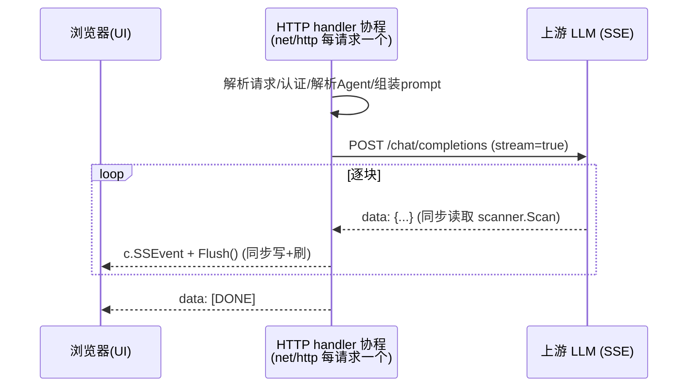
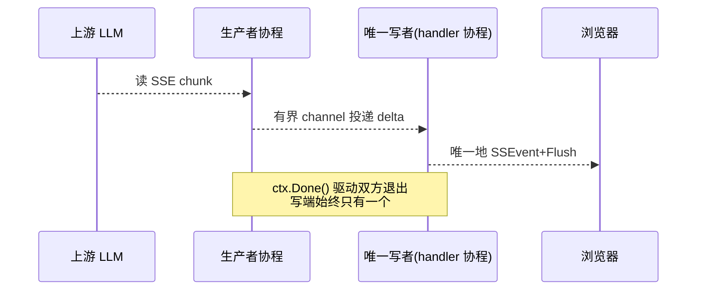

# LLM 配置信息

    主流厂商 context window 一览
    DeepSeek（官网数据）
    模型	Context Length	最大输出
    deepseek-v4-flash	1M (100万)	384K
    deepseek-v4-pro	1M (100万)	384K
    deepseek-v4-flash-vision-exp	1M (100万)	384K
    deepseek-v3 / v3.1 / v3.2 / r1（旧）	128K	—
    Qwen 通义千问（阿里云百炼）
    模型	上下文窗口
    qwen3.8-max / qwen3.7-max	1M
    qwen3.7-plus / qwen3.7-flash	1M
    qwen3-coder-plus / coder-flash	1M
    qwen-long（超长文本专用）	10M (1000万)
    qwen-turbo / qwq-plus	128K
    qwen3 系列开源版	128K~256K
    GLM 智谱（开放平台 + 百炼三方）
    模型	上下文窗口	最大输出
    GLM-4-Plus	128K	4K
    GLM-4-Air-250414	128K	16K
    GLM-4-AirX	8K（低延迟版，注意偏小）	4K
    GLM-4-Flash-250414 / FlashX	128K	16K
    glm-5.2（最新，百炼）	1M	—
    glm-5 / 5.1 / 4.7	198K	—
    glm-4.5	128K	—
    Kimi（月之暗面）& MiniMax
    模型	上下文窗口
    kimi-k2.7-code	256K
    kimi-k2.5 / k2-thinking	256K
    MiniMax-M3	192K
    mimo-v2.5-pro	1M
    MiniMax-M2.7 / M2.5 / M2.1	192K / 200K

# 项目简介

## 1. done

- 生成SSL所需的cert/key文件命令：(open command line with Administrator)
  - 生成CA私钥
    openssl genrsa -out ca.key 2048 //生成CA私钥
  - 生成CA根证书
    openssl req -x509 -new -nodes -key ca.key -sha256 -days 3650 -out ca.crt -subj "/C=CN/ST=Beijing/L=Beijing/O=Dev/CN=Local CA"
  - 生成服务器私钥
    openssl genrsa -out server.key 2048
  - 生成CSR（不包含SAN）
    openssl req -new -key server.key -out server.csr  -subj "/C=CN/ST=Beijing/L=Beijing/O=Dev/CN=localhost"
    - 使用CA签署，同时添加SAN
      - 创建server.cnf文件，其文件内容：
        [req]
        default_bits = 2048
        prompt = no
        default_md = sha256
        distinguished_name = dn
        req_extensions = v3_req

        [dn]
        C = CN
        ST = Beijing
        L = Beijing
        O = Dev
        CN = localhost
      
        [v3_req]
        keyUsage = keyEncipherment, digitalSignature
        extendedKeyUsage = serverAuth
        subjectAltName = @alt_names
      
        [alt_names]
        DNS.1 = localhost
        DNS.2 = *.localhost
        IP.1 = 127.0.0.1
        IP.2 = ::1
      - 执行1：
        openssl req -new -key server.key -out server.csr -config server.cnf
      - 执行2：
        openssl x509 -req -in server.csr -CA ca.crt -CAkey ca.key -CAcreateserial -out server.crt -days 365 -sha256 -extensions v3_req -extfile server.cnf
  - 验证证书
    openssl x509 -in server.crt -text -noout | findstr "Subject Alternative Name"
  - 添加证书
    certutil -addstore "Root" ca.crt

- 重新生成swagger文档
  - cd D:/MyIdea/CClaw/src/agentService
  - swag fmt ## 清空缓存
  - swag init -d .,./../platformutility,./../cclawservice --parseInternal --parseDependency --parseDependency ## 生成swagger文档

## 7 ChatStream的goroutine处理

### 1、先澄清现状：当前其实已经是「每请求单 goroutine」

我全仓检索过 chat 链路，`ChatStream` 这条路径**没有额外开任何 goroutine**（无 `go func`、无 `make(chan)`）。实际执行模型是：

Go 的 `net/http` 为每个请求分配一个 goroutine，`ChatStream` 的整个「读上游 → 写浏览器 → Flush」循环都在**这一个请求 goroutine 里同步完成**；`onChunk`/`onStatus` 是在 `bufio.Scanner` 的读循环里**同步回调**的。所以实时展示**已经是单 goroutine**，没有并发写、没有共享状态。

### 2、回答：对当前场景，保持单 goroutine 就是最优解，不建议拆

对「纯 SSE 转发」这种场景，单 goroutine（请求协程）天然正确：

1. **无数据竞争**：唯一写响应者，SSE 事件顺序、时序天然正确；若拆成多 goroutine 并发 `c.SSEvent/Flush`，`ResponseWriter` 并发写是**竞态**，会乱序甚至损坏 SSE。
2. **天然背压**：客户端慢 → socket 写缓冲满 → 写阻塞 → 上游读自然变慢，内存不会无限增长；拆开反而要手动做有界 channel 才不至于 OOM。
3. **生命周期简单**：客户端断开/取消 → `ctx` 取消 → 读循环退出 → handler 返回，**无 goroutine 泄漏**；拆开需要自己管理「生产者在 ctx 取消时退出」「close-once 语义」。
4. **持有请求协程不是问题**：每个连接本就独占一个协程，长时间占用不阻塞其它请求（不像某些框架的线程池会耗尽）。

### 3、什么情况下才值得拆成「生产者/消费者」多 goroutine

如果只是现在这样「转发文本」，**不要拆**。只有当未来出现以下需求时再演进：

1. **工具调用 / Agent 多步循环**：在等待下一个 chunk 的同时去执行工具（web_fetch、查库、并行子任务）并聚合，这时「上游读取」和「其余工作」确实需要并发。
2. **流式期间的旁路任务**：心跳、指标上报、超时看门狗等。

届时建议的形态（而非随意开 goroutine）：

关键约束：**写响应只能有一个协程**（channel 汇聚到唯一写者），生产者负责读上游+投递，channel 必须有界，双方都监听 `ctx.Done()` 防泄漏。

### 4、结论与建议

- **现在不用改**：当前单 goroutine 泵是正确的、最简的实现，实时展示已经完全满足（每块到达即 `Flush` 到浏览器）。
- **UI 若感觉「不够实时」**，瓶颈不在并发模型，而在两点：①首 token 延迟（TTFB）——等待期我们已发 `status: thinking` 占位；②逐块 flush 已做到，无需改动。
- **等做「工具调用循环」时**，再按上面的生产者/消费者结构演进，并把「上游读取」抽成可注入的组件，其它逻辑（写端、错误、取消）保持不变。

需要的话，将来落地工具调用时我可以按这个结构来设计，届时再把这段分析沉淀到 repo memory。

# 2 todo 需要压缩或流式输出很慢的原因
B. 压缩 system prompt（调低 60K 预算 / 精简大文件正文）	中等，降低 prefill	cclawservice_const.go 预算常量 + 文档内容
C. 给 agent/provider/skills 加内存缓存	低-中，省每次请求的 DB 往返	repo 层加缓存（参照 prompt 的指纹缓存模式）
D. 对 TTFT 敏感场景改用 deepseek-v4-flash 或调低推理强度	直接降低首 token 延迟	agent 配置 primary_model

